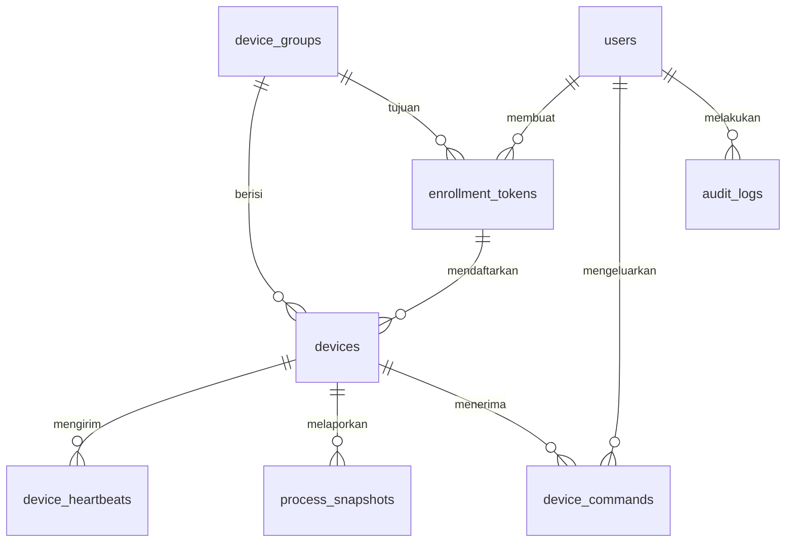

# NetWatch

Dashboard monitoring dan maintenance komputer di jaringan perusahaan (konsep mirip Veyon, berbasis web).
Terdiri dari dua bagian:

| Bagian | Lokasi | Teknologi | Dipasang di |
|---|---|---|---|
| **Server pusat** | `server/` | PHP 8.3+, Laravel 12/13, PostgreSQL | Komputer induk |
| **Agent** | `agent/` | PHP murni (tanpa Composer) | Setiap komputer user (Windows/Linux) |

Agent **memanggil keluar** ke server (heartbeat tiap 30 dtk). Server tidak perlu membuka koneksi ke PC user,
jadi tidak ada port masuk yang harus dibuka di firewall user. Perintah dari dashboard diambil agent pada heartbeat berikutnya.

## Fitur
- Status online/offline, CPU, RAM, disk, uptime, dan user yang sedang login per komputer.
- **Daftar proses ala Task Manager**, akhiri proses, muat ulang daftar.
- Kirim pesan ke layar user, restart/shutdown (khusus admin).
- Grup perangkat, token pendaftaran sekali pakai, peran admin/operator/viewer, audit log.

## Keamanan (ringkas)
- Token agent & token pendaftaran hanya disimpan sebagai hash SHA-256; HTTPS wajib (agent menolak HTTP polos).
- Agent hanya menjalankan perintah **whitelist** (tanpa shell bebas), argumen dikirim sebagai array, proses sistem dilindungi di server **dan** agent, PID diverifikasi ulang sebelum di-kill.
- Rate limit login/agent, CSRF, header keamanan, kata sandi min. 12 karakter, retensi data otomatis.

## Struktur
```
server/   app/{Enums,Models,Services,Http,Console} · database/migrations · routes · resources/views · tests
agent/    bin/netwatch-agent · src/{Agent,Command,Config,Dto,Enrollment,Http,Platform,Support} · install/{linux,windows} · tests
docs/     schema.sql (skema referensi PostgreSQL)
```

## ERD

Detail kolom/indeks: `docs/schema.sql` dan `server/database/migrations`.

## Instalasi server (komputer induk)
Prasyarat: PHP 8.3+ (pdo_pgsql, mbstring, curl, xml), Composer, PostgreSQL 15+, Nginx/Apache dengan sertifikat TLS.
```bash
cd server
composer install --no-dev --optimize-autoloader
cp .env.example .env && php artisan key:generate
# isi DB_* dan APP_URL di .env, buat database & user PostgreSQL terlebih dahulu
php artisan migrate --force
php artisan netwatch:create-user admin@perusahaan.local --name="Admin" --role=admin
php artisan config:cache && php artisan route:cache && php artisan view:cache
```
Arahkan web root ke `server/public`, lalu tambahkan cron: `* * * * * php /path/server/artisan schedule:run`.
HTTPS: gunakan sertifikat dari CA internal perusahaan; bagikan file CA ke PC user (opsi `--ca-file`).

## Instalasi agent (komputer user)
1. Di dashboard: **Token Pendaftaran** → buat token (pilih grup, jumlah pakai, masa berlaku).
2. Salin folder `agent/` ke PC user, lalu:

**Linux** (butuh `php-cli` ≥ 8.2 + curl, mbstring):
```bash
sudo NETWATCH_ENROLL_TOKEN=<token> ./install/linux/install.sh --server=https://netwatch.perusahaan.local --ca-file=ca.pem
```
**Windows** (PowerShell Administrator; letakkan PHP portabel di `agent\runtime\php` atau pasang PHP di PATH):
```powershell
.\install\windows\install.ps1 -Server https://netwatch.perusahaan.local -CaFile C:\temp\ca.pem
```
Untuk penyebaran massal di Windows, bangun installer `.exe` (lihat `docs/PENYEBARAN-AGENT.md`).
Agent berjalan sebagai layanan systemd / scheduled task SYSTEM dan start otomatis saat boot.
Hapus dengan `uninstall.sh` / `uninstall.ps1`; lalu hapus perangkat di dashboard.

## Pengujian
- Agent: `php agent/tests/run.php`
- Server: buat database `netwatch_test`, lalu `cd server && php artisan test` (wajib PostgreSQL). Jika perintah `test` tidak dikenal: `composer require --dev nunomaduro/collision` atau jalankan `vendor/bin/phpunit`.

## Catatan jujur tentang status verifikasi
Kode server (Laravel) lolos `php -l` tetapi **belum dijalankan** karena `composer install` tidak tersedia saat dibuat;
jalankan `php artisan test` setelah instalasi dan laporkan bila ada yang gagal. Agent sudah diuji ujung-ke-ujung
terhadap server tiruan di Linux; jalur Windows (PowerShell/WMI, installer `.ps1`) belum diuji di mesin Windows.
Sebelum produksi: uji di beberapa PC pilot dan review izin yang diberikan pada akun SYSTEM.

## Roadmap berikutnya
Layar remote view/kontrol (VNC/WebRTC), inventaris perangkat lunak, jadwal tugas maintenance, notifikasi offline, MFA dashboard.
