# Activity Diagram — sisi perangkat (agent ↔ server)

Dokumen ini menggambarkan **alur kerja nyata** yang dijalankan agent di PC dan server NetWatch saat berhubungan. Setiap diagram dibuat dari kode (rujukan berkas ada di bawah tiap diagram), bukan dari rancangan awal. Dipakai untuk **troubleshooting**: temukan langkah tempat alur berhenti, lalu lihat tabel "titik gagal" di bawahnya.

Dokumen pasangan: [`ACTIVITY-DIAGRAM-SERVER.md`](ACTIVITY-DIAGRAM-SERVER.md) (alert, notifikasi, NOC, tiket, backup, retensi), [`API-AGENT.md`](API-AGENT.md) (kontrak API), [`AGENT-INTERNAL.md`](AGENT-INTERNAL.md), [`ERD.md`](ERD.md), [`KODE-EVENT.md`](KODE-EVENT.md).

> **Cara membaca.** Kotak biru = langkah di agent (PC klien). Kotak hijau = langkah di server (Laravel). Kotak abu = database. Belah ketupat = keputusan. Garis putus-putus = jalur galat. Semua waktu di database UTC; tampilan dashboard memakai `NETWATCH_TIMEZONE` (Asia/Jakarta).

Daftar alur:

| # | Alur | Pemicu |
|---|---|---|
| A1 | [Pendaftaran perangkat (enrollment)](#a1-pendaftaran-perangkat-enrollment) | Installer / `netwatch-agent enroll` |
| A2 | [Siklus hidup agent (loop utama)](#a2-siklus-hidup-agent-loop-utama) | Agent berjalan (tugas SYSTEM / systemd) |
| A3 | [Heartbeat diterima server](#a3-heartbeat-diterima-server) | `POST /api/agent/v1/heartbeat` |
| A4 | [Status online/offline dan riwayat uptime](#a4-status-onlineoffline-dan-riwayat-uptime) | Heartbeat + scheduler tiap menit |
| A5 | [Perintah dari dashboard ke PC](#a5-perintah-dari-dashboard-ke-pc) | Operator menekan tombol di halaman perangkat |
| A6 | [Kebijakan blokir (policy)](#a6-kebijakan-blokir-policy) | Policy diubah / heartbeat membawa hash |
| A7 | [Inventaris: port, layanan, perangkat keras, perangkat lunak](#a7-inventaris-port-layanan-perangkat-keras-perangkat-lunak) | Timer agent 5–10 menit |
| A8 | [Bandwidth: counter jadi sampel](#a8-bandwidth-counter-jadi-sampel) | Setiap heartbeat |
| A9 | [Browsing dan Windows Event Log](#a9-browsing-dan-windows-event-log) | Timer agent 2 / 5 menit |
| A10 | [Snapshot proses (Task Manager jarak jauh)](#a10-snapshot-proses-task-manager-jarak-jauh) | Timer 5 menit atau perintah `refresh_processes` |
| A11 | [Pencabutan, pemasangan ulang, dan pencopotan agent](#a11-pencabutan-pemasangan-ulang-dan-pencopotan-agent) | Admin mencabut / installer / uninstall |

---

## A1. Pendaftaran perangkat (enrollment)

**Aktor:** teknisi/installer, agent, server. **Hasil:** PC punya `device_id` dan `api_token` (disimpan agent di `agent.json`, server hanya menyimpan **hash SHA-256**-nya).

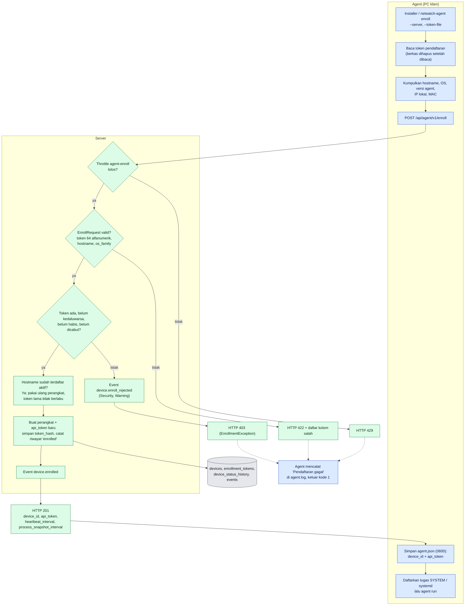

**Langkah:**
1. Agent membaca token dari `--token-file` (lalu **menghapus berkas**), `--token`, atau variabel `NETWATCH_ENROLL_TOKEN` (`agent/bin/netwatch-agent`, `readEnrollToken`).
2. `Enroller` mengumpulkan data perangkat; IP lokal diambil lewat soket UDP ke server (tanpa mengirim paket) (`agent/src/Enrollment/Enroller.php`).
3. Server membatasi laju (`agent-enroll`, 10/menit per IP), memvalidasi (`EnrollRequest`), lalu `EnrollmentService` memeriksa token. Hostname yang sudah aktif **didaftarkan ulang** (perangkat sama, token lama tidak berlaku lagi).
4. Respons 201 hanya berisi `device_id` (public id), `api_token` (ditampilkan **sekali**), dan interval. Agent menyimpan lewat tulis-atomik (`agent.json.tmp` → rename).

**Titik gagal**

| Titik | Gejala | Cara cek | Tindakan |
|---|---|---|---|
| Server tidak terjangkau | `Tidak dapat terhubung ke server: …` di `agent.log` | `curl -kI https://SERVER/login` dari PC itu; cek DNS/firewall | Perbaiki jaringan/URL; tes dengan `--ca-file` bila CA internal |
| Sertifikat tidak dipercaya | `SSL certificate problem` | Pasang CA lewat installer `/CAFILE=…` | Berikan `ca.pem` ke agent (`ca_file` di `agent.json`) |
| URL `http://` | `Server harus memakai HTTPS` | Lihat `server_url` | Pakai `https://`; `--allow-insecure-http` hanya uji coba |
| HTTP 403 | `Pendaftaran gagal … Token pendaftaran tidak valid atau sudah kedaluwarsa.` | Dashboard → Event → `device.enroll_rejected` (hostname + IP; alasan sengaja **tidak** dibedakan agar tidak membantu penyerang) | Di menu Token Pendaftaran periksa: kedaluwarsa? `used_count` = `max_uses`? dicabut? Salah salin (64 karakter)? Bila ragu, buat token baru |
| HTTP 422 | Pesan validasi | Isi `message`/`errors` pada respons | Hostname berisi karakter terlarang (spasi, `_` di awal) → ganti nama PC |
| HTTP 429 | Terlalu sering mencoba | Tunggu 1 menit | Jangan menjalankan enroll dalam loop |
| `agent.json` tidak tertulis | Enroll sukses tetapi agent tak jalan | Izin folder `C:\ProgramData\NetWatch` | Jalankan sebagai SYSTEM/Administrator |

---

## A2. Siklus hidup agent (loop utama)

**Rujukan:** `agent/src/Agent.php`. Satu putaran = satu heartbeat; tugas lain berjalan bila timernya jatuh tempo.

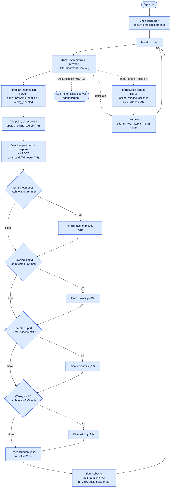

**Catatan penting untuk troubleshooting**
- Tugas sekunder (browsing, inventaris, aset, winlog) dibungkus `guarded()`: kegagalannya **hanya dicatat sebagai peringatan** di `agent.log` dan tidak menghentikan heartbeat. Jadi PC tampak online walau datanya tidak masuk.
- **Hanya** `ApiException` dengan status 401/403 yang menghentikan agent. Selain itu agent terus mencoba dengan backoff.
- Interval dari server dibatasi 5–3600 detik; nilai tidak numerik diabaikan.
- Saat dihentikan (SIGTERM/SIGINT) agent selesai di sela tidur 250 ms, lalu log `Agent berhenti.`

| Titik | Gejala | Cara cek | Tindakan |
|---|---|---|---|
| Agent tidak jalan | PC offline di dashboard, tak ada log baru | Windows: `schtasks /Query /TN NetWatchAgent`; Linux: `systemctl status netwatch-agent` | Mulai tugas/layanan; baca `agent.log` |
| 401 berulang | Log `Token ditolak server … Agent berhenti.` | Dashboard: perangkat berstatus dicabut? | Daftarkan ulang dengan token baru (A11) |
| Server mati/jaringan putus | `Gagal berkomunikasi dengan server` + jeda makin panjang | `ping`/`curl` ke server | Pulihkan server; agent pulih sendiri (maks. jeda ±72 detik) |
| Data tertentu tak masuk | Peringatan `Gagal mengirim data … (dicoba lagi)` | `agent.log` | Lihat alur A7/A9 yang bersangkutan |
| Waktu PC salah | Grafik/alert aneh, winlog ditolak | Bandingkan `server_time` di respons heartbeat dengan jam PC | Sinkronkan NTP |

---

## A3. Heartbeat diterima server

**Rujukan:** `HeartbeatController`, `HeartbeatService::record`, `PolicySync::sync`, `CommandService::claimPending`, `StatusTracker`.

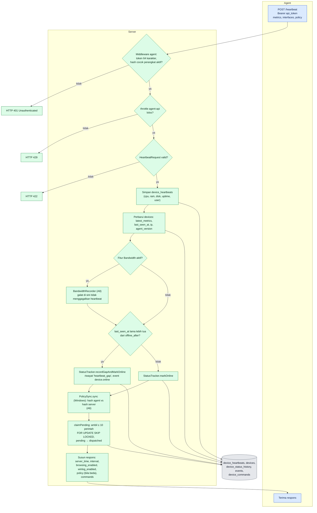

| Titik | Gejala | Cara cek | Tindakan |
|---|---|---|---|
| 401 | Agent berhenti, perangkat "dicabut" | `devices.revoked_at`; `SELECT … WHERE token_hash = sha256(token)` | Daftarkan ulang |
| 422 | Log agent: `HTTP 422` | `storage/logs/laravel.log` / respons `errors` | Biasanya `cpu_percent` di luar 0–100 atau metrik negatif → bug collector; kirim `agent.log` |
| 429 | Agent mengirim > 240 permintaan/menit | Batas `agent-api` = 240/menit **per token** (hash), bukan per IP; ada di `AppServiceProvider` | Biasanya loop bug di agent; periksa `agent.log` |
| 500 | Agent mencoba terus dengan backoff | `storage/logs/laravel.log` | Periksa DB (koneksi, `DB_SCHEMA`), izin `storage/` |
| Perangkat online tetapi grafik kosong | `device_heartbeats` tidak bertambah | `SELECT max(recorded_at) FROM device_heartbeats WHERE device_id=…` | Cek retensi/prune, jam server |
| Perintah tak sampai | Status tetap `pending` | Lihat A5 | Pastikan heartbeat berjalan (perintah hanya dikirim lewat respons heartbeat) |

---

## A4. Status online/offline dan riwayat uptime

**Rujukan:** `StatusTracker`, `netwatch:check-status` (tiap menit), `netwatch:ping-offline` (tiap menit), `PingService`, `UptimeCalculator`.

Prinsip: **offline dihitung dari heartbeat terakhir**, bukan dari saat scheduler menandainya. Riwayat disimpan sebagai interval (`device_status_history`) dengan indeks unik parsial agar satu perangkat hanya punya **satu interval terbuka**.

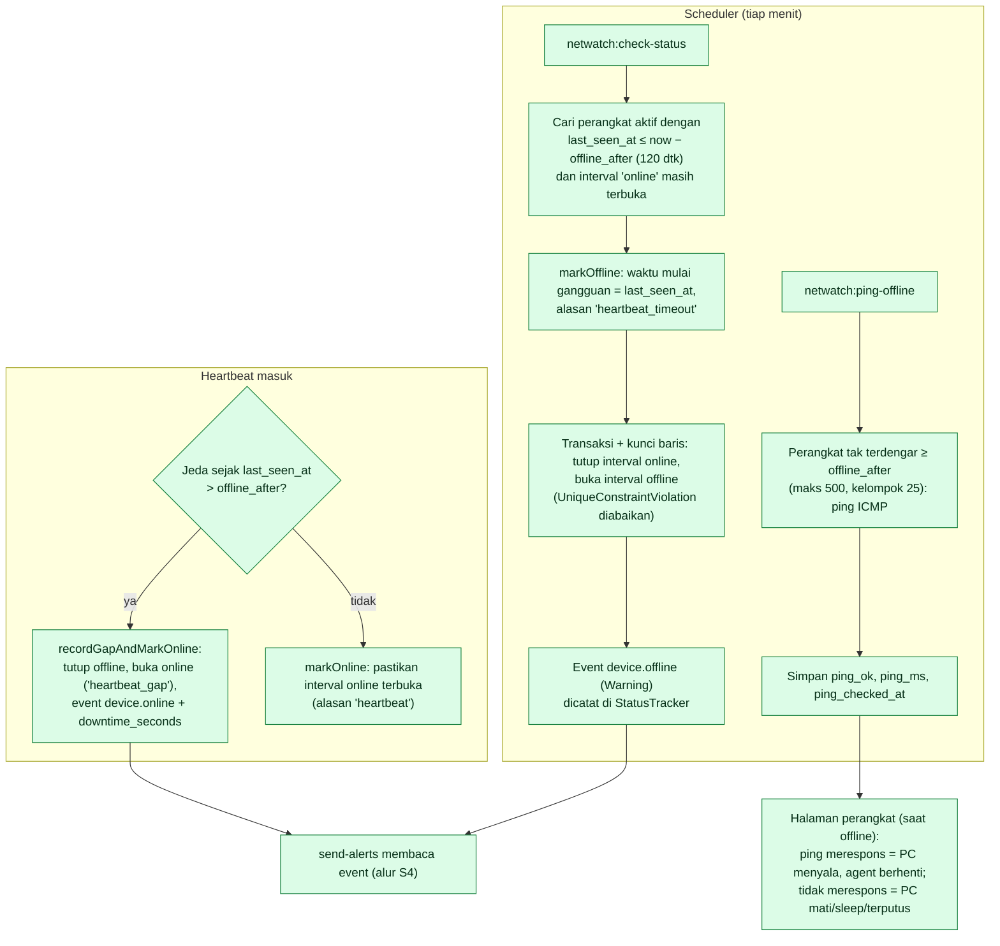

**Arti status di dashboard**
- *Online*: ada interval online terbuka dan `last_seen_at` dalam batas `offline_after`.
- *Offline*: interval offline terbuka. `ping_ok` membantu membedakan: `true` = PC hidup tetapi agent/ jaringan agent bermasalah; `false` = PC mati/terputus.
- *Maintenance*: `maintenance_until` di masa depan. Pencatatan status/uptime **tetap berjalan**; yang dilewati hanyalah evaluasi alert threshold (`AlertEvaluator`) dan pengiriman notifikasi (`AlertDispatcher`) untuk perangkat ini.
- Event `device.offline`/`device.online` baru dibuat pada **perubahan nyata**; pembukaan riwayat pertama (saat enroll) tidak menghasilkan event.
- Waktu kejadian event offline = `last_seen_at` (bukan waktu scheduler berjalan), sehingga lama downtime akurat walau scheduler sempat tertunda.

| Titik | Gejala | Cara cek | Tindakan |
|---|---|---|---|
| Scheduler tidak jalan | Perangkat mati tetap "online" | Halaman **Keamanan** → "Penjadwal"; `crontab -l`; `artisan schedule:list` | Pasang cron (`DEPLOY-LINUX.md` §7); `artisan schedule:run` manual |
| Banyak perangkat offline bersamaan | Event massal (diringkas notifikasi jika ≥ 5) | Cek switch/AP, server NetWatch, sertifikat kedaluwarsa | Pulihkan jalur; jangan cabut perangkat |
| Flapping online/offline | Banyak event `device.online/offline` | `SELECT * FROM device_status_history WHERE device_id=… ORDER BY started_at DESC` | Naikkan `NETWATCH_OFFLINE_AFTER`, cek kabel/WiFi/sleep |
| Offline padahal PC menyala | `ping_ok = true` | `agent.log`; layanan agent | Restart tugas/layanan agent; cek firewall ke server |
| Uptime % janggal | Laporan beda dengan harapan | `UptimeCalculator` memotong interval ke jendela laporan; data sebelum enroll dihitung "tidak ada data" | Bandingkan dengan interval mentah di tabel |
| Interval ganda terbuka | Seharusnya mustahil (indeks unik) | `SELECT device_id,count(*) FROM device_status_history WHERE ended_at IS NULL GROUP BY 1 HAVING count(*)>1` | Laporkan sebagai bug; sertakan hasil query |

---

## A5. Perintah dari dashboard ke PC

**Rujukan:** `DeviceCommandController`, `StoreDeviceCommandRequest`, `CommandService`, `CommandResultController`, `netwatch:expire-commands`, `agent/src/Command/CommandExecutor.php`.

Jenis perintah (`CommandType`): `refresh_processes`, `terminate_process`, `send_message`, `restart_computer`, `shutdown_computer`. Hak: Admin & Operator (`run-commands`); Viewer hanya melihat.

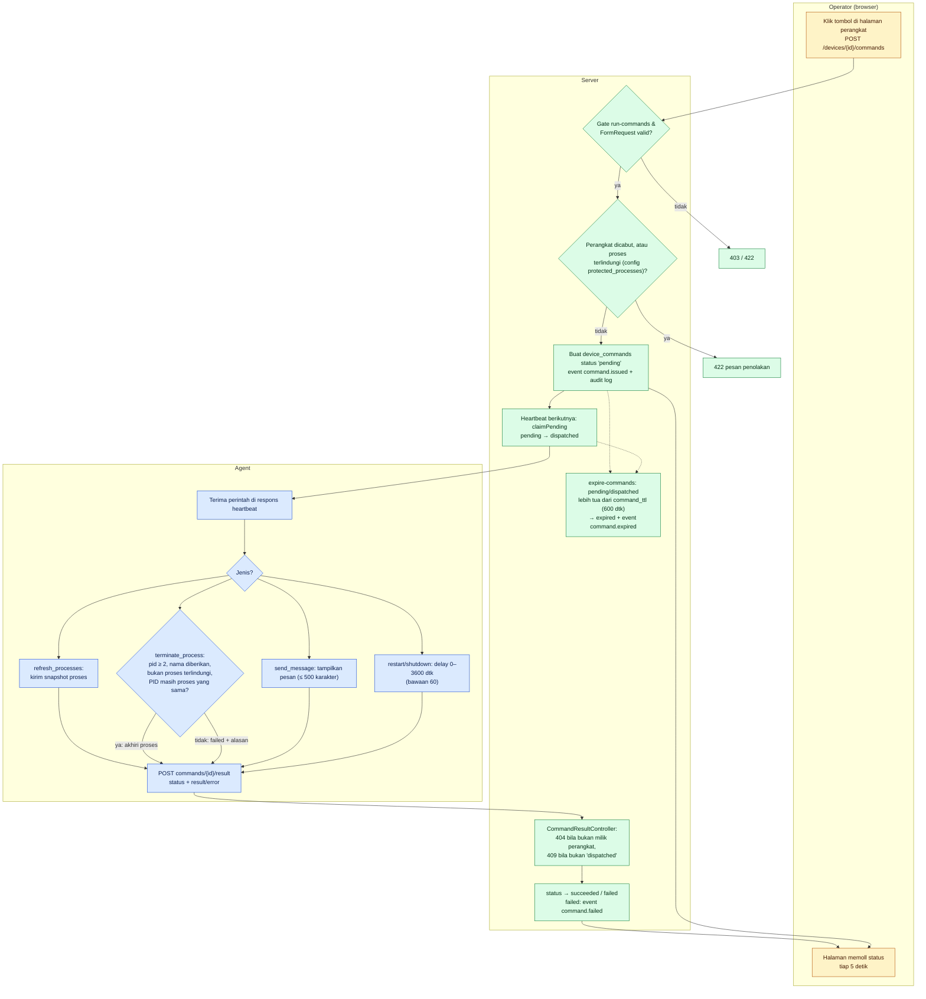

**Status perintah:** `pending → dispatched → succeeded | failed`, atau `expired` bila tak diambil/diselesaikan dalam `NETWATCH_COMMAND_TTL` (600 detik).

| Titik | Gejala | Cara cek | Tindakan |
|---|---|---|---|
| Tetap `pending` | Tidak ada reaksi di PC | Apakah perangkat online? (A4). Perintah hanya diambil saat heartbeat. | Tunggu satu interval (30 dtk); bila offline, perintah menjadi `expired` setelah 10 menit |
| `expired` | Event `command.expired` | `SELECT * FROM device_commands WHERE device_id=… ORDER BY id DESC` | Ulangi saat perangkat online |
| `failed`: "dilindungi" | Pesan `Proses '…' dilindungi` | Daftar di `config/netwatch.php` + `ProtectedProcesses` agent | Memang disengaja; proses sistem tidak boleh diakhiri |
| `failed`: "PID … sekarang milik proses lain" | PID dipakai ulang OS | Refresh daftar proses lalu coba lagi | Normal; mencegah salah-bunuh |
| `failed`: tanpa hak | Gagal `taskkill`/`kill` | `agent.log` (galat platform) | Agent harus berjalan sebagai SYSTEM/root |
| 404 / 409 pada `result` | Log agent `HTTP 404/409` | Perintah milik perangkat lain, atau sudah diselesaikan/kedaluwarsa | Abaikan; agent tidak mengulang |
| Restart/shutdown tak terjadi | Status `succeeded` tetapi PC hidup | Delay (bawaan 60 dtk) dan pembatalan manual pengguna | Cek `shutdown /a`; gunakan delay 0 untuk uji |

---

## A6. Kebijakan blokir (policy)

**Rujukan:** `PolicyBuilder::forDevice`, `PolicySync`, `BlockRuleGuard`, `agent/src/Policy/PolicyApplier.php`, `BlockPolicy`, `HostsFile`. Hanya perangkat **Windows**: agent Linux belum mendukung penerapan blokir (`LinuxPlatform::applyBlockPolicy` melempar "belum didukung" bila ada aturan). Detail fitur ada di [`BLOKIR.md`](BLOKIR.md).

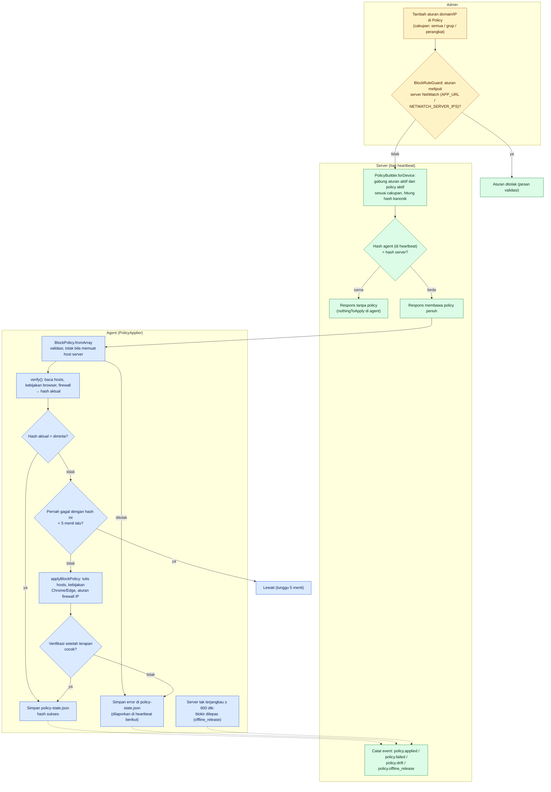

**Pengaman yang sengaja ada:** (1) aturan yang meliputi server NetWatch ditolak server **dan** agent; (2) blokir dilepas otomatis bila PC lama tak bisa menghubungi server (di luar jaringan kantor); (3) setiap penerapan **diverifikasi** dengan membaca kembali sistem; (4) `netwatch-agent clear-policy` dan `recover-policy.ps1` untuk darurat.

| Titik | Gejala | Cara cek | Tindakan |
|---|---|---|---|
| `policy.failed` | Event Warning + pesan galat | Halaman perangkat → status policy; `agent.log` | Agent harus SYSTEM; antivirus mengunci `hosts`; GPO mengatur firewall penuh |
| `policy.drift` | Hash aktual ≠ yang diminta | Seseorang mengubah `hosts` / registry | Server mengirim ulang otomatis; bila berulang telusuri pelakunya |
| Situs tak terblokir | Policy tampil "diterapkan" | Browser memakai DoH/VPN/proxy; cache DNS | `ipconfig /flushdns`; tutup browser; cek kebijakan Chrome/Edge di `chrome://policy` |
| Semua situs terblokir / server tak bisa dibuka | Aturan terlalu luas | `BlockRuleGuard` seharusnya menolak | Jalankan `netwatch-agent clear-policy` atau `install\windows\recover-policy.ps1 -Apply` |
| Policy tidak turun ke PC | Hash tak pernah berubah | Perangkat Linux (tidak didukung), policy nonaktif, cakupan salah | Periksa `policies.is_enabled`, grup perangkat, OS |

---

## A7. Inventaris: port, layanan, perangkat keras, perangkat lunak

**Rujukan:** `InventoryController/Recorder` (port & layanan, tiap 10 menit), `AssetsController`/`AssetRecorder` (aset, tiap 5 menit). Dapat dimatikan lewat saklar fitur **Inventaris**.

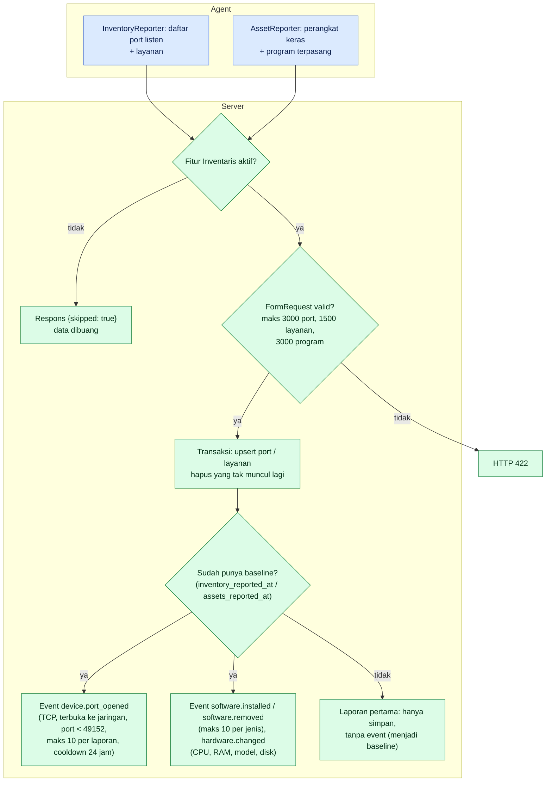

Catatan: `hardware = null` atau `software = null` artinya agent **gagal membaca** bagian itu; data lama dipertahankan (bukan dihapus). Program yang berganti versi dianggap pembaruan, bukan instal/uninstal.

| Titik | Gejala | Cara cek | Tindakan |
|---|---|---|---|
| Halaman Inventaris kosong | Belum ada laporan | `devices.inventory_reported_at`, `assets_reported_at` | Tunggu 10 menit setelah agent start; cek saklar **Fitur** |
| Banjir event `device.port_opened` | Aplikasi sering restart | Batas 10/laporan dan cooldown 24 jam sudah ada | Abaikan atau tutup port yang tak perlu |
| Event `software.removed` palsu | Agent gagal membaca daftar sebagian | `agent.log` | Agent mengirim `null` bila gagal total, tetapi daftar parsial akan dianggap uninstal; perbaiki sumber galat |
| Agent lama | Tidak ada data aset | Inventaris perangkat keras/lunak butuh agent 1.6.0+ | Pasang agent terbaru |

---

## A8. Bandwidth: counter jadi sampel

**Rujukan:** `BandwidthRecorder`, `BandwidthMath::delta`, `BandwidthRollup`. Agent mengirim **counter kumulatif** (`rx_bytes`, `tx_bytes`) per interface di setiap heartbeat; server menghitung selisihnya.

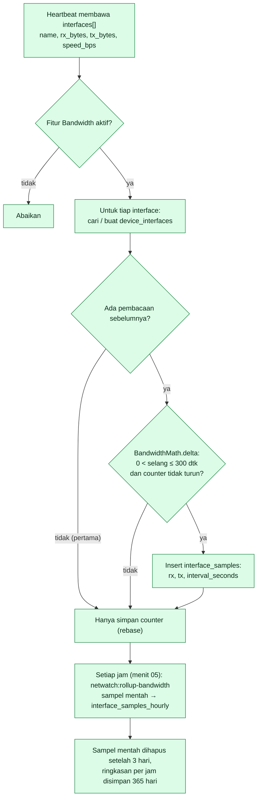

| Titik | Gejala | Cara cek | Tindakan |
|---|---|---|---|
| Grafik bolong | Selang heartbeat > 300 dtk atau counter reset (reboot) | Disengaja: sampel tak valid dibuang, bukan diratakan | Normal; periksa kestabilan jaringan bila sering |
| Grafik kosong sama sekali | Fitur mati / agent lama | Menu **Fitur**; `device_interfaces` untuk perangkat | Aktifkan; update agent |
| Nilai terlalu besar | Dua adapter virtual terhitung | Lihat daftar interface di halaman bandwidth | Abaikan adapter virtual (Hyper-V/VPN) |
| Rollup tertinggal | Grafik 7 hari tak lengkap | `SELECT max(hour) FROM interface_samples_hourly` | Pastikan scheduler jalan; `artisan netwatch:rollup-bandwidth` manual (maks 14 hari per eksekusi) |

---

## A9. Browsing dan Windows Event Log

**Rujukan:** `agent/src/Browsing/*`, `BrowsingRecorder`, `BrowsingRollup`, `agent/src/Winlog/WinlogReporter.php`, `WinlogRecorder`, `WinlogClassifier`. Keduanya **dimatikan secara bawaan**; server memberi tahu agent lewat `browsing_enabled` / `winlog_enabled` di respons heartbeat. Pertimbangan privasi: [`BROWSING.md`](BROWSING.md).

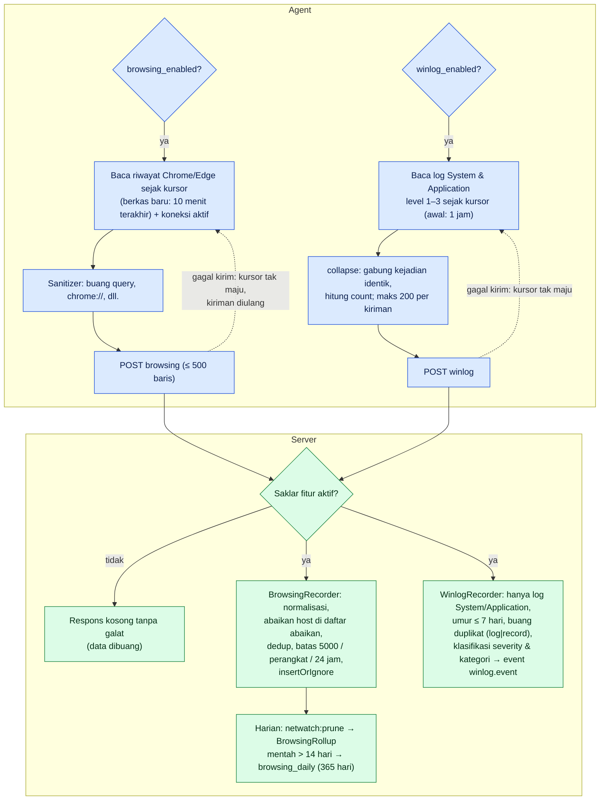

| Titik | Gejala | Cara cek | Tindakan |
|---|---|---|---|
| Browsing kosong | Saklar mati di server atau `.env` | Menu **Fitur**; `NETWATCH_BROWSING_ENABLED` | Aktifkan (cek kebijakan privasi perusahaan) |
| Hanya koneksi IP, tanpa URL | `pdo_sqlite` tidak ada | `agent.log`: "Ekstensi pdo_sqlite tidak ada" | Pasang ulang agent dari installer terbaru |
| Riwayat Chrome terkunci | `warnOnce` log per jam | `agent.log` | Normal bila browser sedang menulis; dicoba lagi |
| `over_limit` > 0 | Satu PC mengirim terlalu banyak | Respons `over_limit`; `NETWATCH_BROWSING_MAX_PER_DEVICE_DAY` | Tambah domain abaikan (CDN/iklan) atau naikkan batas |
| Winlog kosong | Saklar mati / sumber tidak ada | `NETWATCH_WINLOG_ENABLED`, menu Fitur; di Linux butuh `journalctl` (systemd) | Aktifkan. Sumber: Windows Event Log (agent 1.4.0+) dan journald Linux (1.5.0+, prioritas `err`) |
| Pesan winlog tampak terpotong | Dipotong 300 karakter dan karakter kontrol dibuang | Disengaja | Lihat Event Viewer Windows untuk aslinya |
| Tabel browsing membengkak | > 3 juta baris | Halaman **Keamanan** → "Volume data browsing" | Pastikan `netwatch:prune` jalan; turunkan `NETWATCH_RETENTION_BROWSING` |

---

## A10. Snapshot proses (Task Manager jarak jauh)

**Rujukan:** `ProcessSnapshotController`, `ProcessSnapshotService`, `agent/src/Command/ProcessReporter.php`. Inilah dasar fitur "cek task manager" di halaman perangkat.

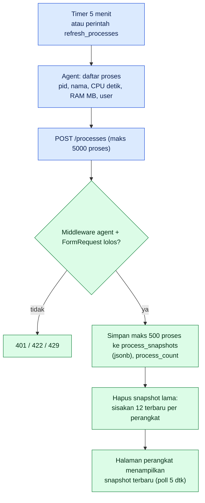

| Titik | Gejala | Cara cek | Tindakan |
|---|---|---|---|
| Daftar proses lama | Waktu snapshot tertinggal | Kolom `captured_at` | Klik "Segarkan" (perintah `refresh_processes`) |
| Daftar terpotong | Proses > 500 | `max_processes_per_snapshot` | Disengaja (urut sesuai agent) |
| CPU proses tampil kumulatif | Agent mengirim `cpu_seconds` total | Bukan persentase | Bandingkan dua snapshot |

---

## A11. Pencabutan, pemasangan ulang, dan pencopotan agent

**Rujukan:** `DeviceController::destroy`, `Device::active()`, `NetWatchAgent.iss`, `install.ps1`, `uninstall.ps1`, `recover-policy.ps1`, `netwatch-agent clear-policy`.

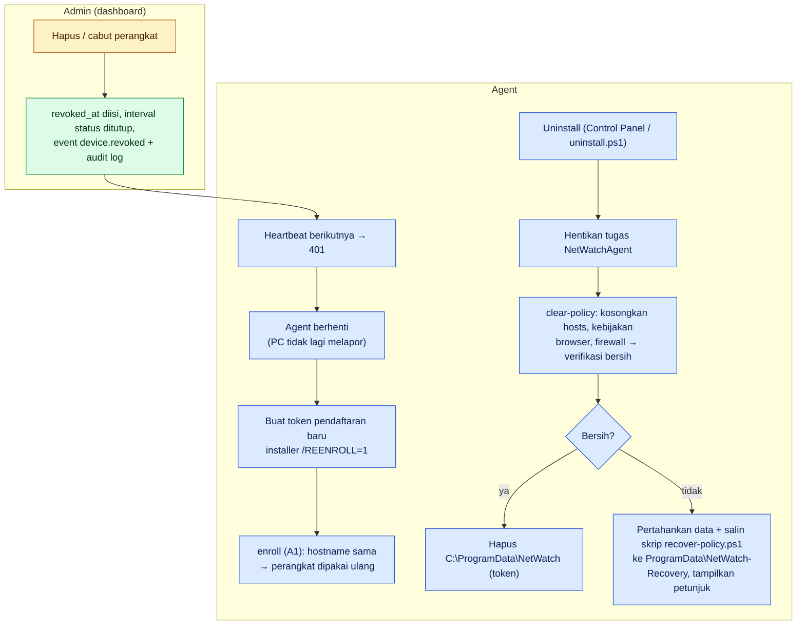

| Titik | Gejala | Cara cek | Tindakan |
|---|---|---|---|
| Setelah uninstal situs tetap terblokir | `clear-policy` gagal | Pesan "Blokir NetWatch belum bisa dibersihkan" | Jalankan `recover-policy.ps1` (periksa tanpa `-Apply`, lalu dengan `-Apply`) sebagai Administrator |
| Perangkat ganda di dashboard | Hostname berubah sebelum enroll ulang | `devices` per hostname/MAC | Cabut entri lama |
| Reinstal tanpa token baru | Agent memakai `agent.json` lama | Token lama masih valid? (belum dicabut) | Cukup restart agent; token baru hanya bila dicabut |

---

## Lampiran — ringkasan jalur HTTP agent

| Jalur | Dipicu oleh | Autentikasi | Respons sukses |
|---|---|---|---|
| `POST enroll` | A1 | token pendaftaran | 201 |
| `POST heartbeat` | A2/A3 | Bearer | 200 |
| `POST processes` | A10 | Bearer | 201 |
| `POST inventory` | A7 | Bearer | 201 / `{skipped}` |
| `POST assets` | A7 | Bearer | 201 / `{skipped}` |
| `POST browsing` | A9 | Bearer | 201 / `{stored:0}` bila fitur mati |
| `POST winlog` | A9 | Bearer | 201 / `{stored:0}` bila fitur mati |
| `POST commands/{id}/result` | A5 | Bearer | 200 |

Detail muatan, kode status, dan contoh `curl` ada di [`API-AGENT.md`](API-AGENT.md).
