# Activity Diagram — sisi server (dashboard, alert, NOC, tiket, backup, retensi)

Pasangan dari [`ACTIVITY-DIAGRAM-PERANGKAT.md`](ACTIVITY-DIAGRAM-PERANGKAT.md). Dokumen ini mencakup alur yang **berjalan di server atau browser operator**, bukan di PC klien. Seluruh diagram dibuat dari kode (rujukan berkas di bawah tiap diagram).

> **Warna.** Hijau = server Laravel. Kuning/oranye = operator/pengguna di browser. Biru = agent. Abu = database / sistem luar (Telegram, SMTP, `pg_dump`). Garis putus-putus = jalur galat.

| # | Alur | Pemicu |
|---|---|---|
| S1 | [Login, hak akses, dan saklar fitur](#s1-login-hak-akses-dan-saklar-fitur) | Pengguna membuka dashboard |
| S2 | [Evaluasi alert ambang (CPU/RAM/Disk)](#s2-evaluasi-alert-ambang-cpuramdisk) | Scheduler tiap menit |
| S3 | [Pemantauan target jaringan (NOC)](#s3-pemantauan-target-jaringan-noc) | Scheduler tiap menit / tombol "Ping sekarang" |
| S4 | [Pengiriman notifikasi Telegram/email](#s4-pengiriman-notifikasi-telegramemail) | Scheduler tiap menit |
| S5 | [Alert suara di halaman Jaringan](#s5-alert-suara-di-halaman-jaringan-browser) | Auto-refresh halaman |
| S6 | [Tiket bantuan dan penilaian](#s6-tiket-bantuan-dan-penilaian) | Pengguna akhir / petugas |
| S7 | [Backup database](#s7-backup-database) | Scheduler 01:30 / manual |
| S8 | [Retensi data dan rollup](#s8-retensi-data-dan-rollup) | Scheduler 02:30 dan tiap jam |
| S9 | [Laporan uptime dan auto-refresh dashboard](#s9-laporan-uptime-dan-auto-refresh-dashboard) | Operator membuka halaman |
| S10 | [Pemeriksaan keamanan](#s10-pemeriksaan-keamanan) | Halaman Keamanan / `netwatch:security-check` |
| S11 | [Penjadwal (cron) — peta semua tugas berkala](#s11-penjadwal-cron--peta-semua-tugas-berkala) | `schedule:run` tiap menit |

---

## S1. Login, hak akses, dan saklar fitur

**Rujukan:** `routes/web.php`, `AuthController`, `EnsureActiveUser`, `RequireFeature`, `AppServiceProvider` (Gate & rate limiter), `UserChangeGuard`.

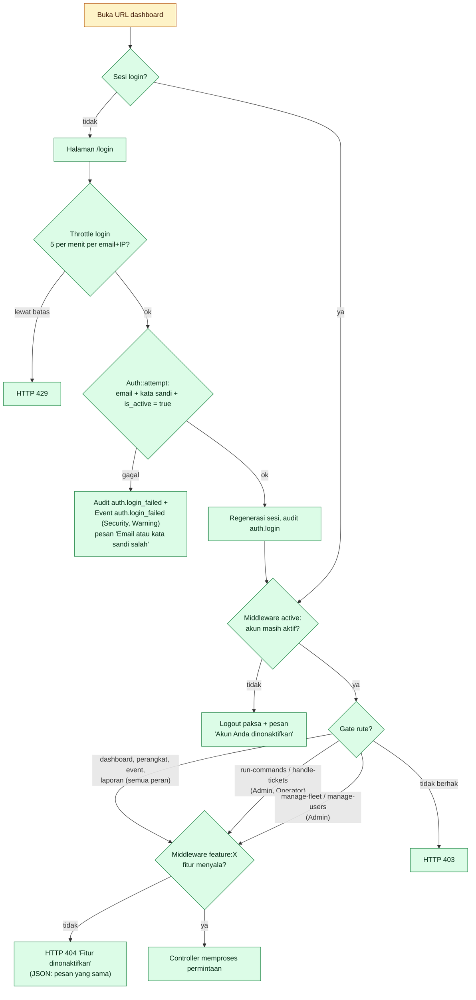

**Matriks peran** (`UserRole`, `AppServiceProvider`)

| Kemampuan | Viewer | Operator | Admin |
|---|:--:|:--:|:--:|
| Lihat dashboard, perangkat, event, laporan uptime, bandwidth | ✔ | ✔ | ✔ |
| Jalankan perintah ke PC (`run-commands`) | – | ✔ | ✔ |
| Tangani tiket (`handle-tickets`) | – | ✔ | ✔ |
| Kelola perangkat, grup, token, policy, jaringan, alert, fitur, keamanan, database, audit, browsing & inventaris (`manage-fleet`) | – | – | ✔ |
| Kelola pengguna (`manage-users`) | – | – | ✔ |

**Pengaman akun:** admin tidak bisa menonaktifkan/menurunkan dirinya sendiri, dan harus tersisa minimal satu admin aktif (`UserChangeGuard`).

| Titik | Gejala | Cara cek | Tindakan |
|---|---|---|---|
| Tidak bisa login | "Email atau kata sandi salah" padahal benar | `users.is_active`, `users.role`; event `auth.login_failed` | Aktifkan akun; reset sandi (`netwatch:create-user` bila belum ada admin) |
| 429 saat login | Terlalu banyak percobaan | 5/menit per kombinasi email + IP (`AppServiceProvider`) | Tunggu 1 menit |
| Terlempar ke login terus | Sesi tidak tersimpan | `SESSION_SECURE_COOKIE=true` tetapi akses lewat `http://`; `APP_KEY` berubah; tabel `sessions` hilang | Akses lewat HTTPS; jangan ganti `APP_KEY`; jalankan migrasi |
| 403 | Menu tidak muncul/ditolak | Peran pengguna | Naikkan peran sesuai kebutuhan |
| 404 "Fitur dinonaktifkan" | Halaman bandwidth/browsing/tiket dll. | Menu **Fitur** (admin); `feature_flags` menimpa `.env` | Aktifkan fitur |
| 419 (page expired) | Form lama dikirim | Token CSRF kedaluwarsa (`SESSION_LIFETIME=120`) | Muat ulang halaman |
| Login berhasil tapi 500 | Skema DB / `DB_SCHEMA` | `storage/logs/laravel.log` | Lihat `MERGE-DATABASE.md` |

---

## S2. Evaluasi alert ambang (CPU/RAM/Disk)

**Rujukan:** `netwatch:evaluate-alerts` → `AlertEvaluator`, `AlertDecision` (murni, teruji). Aturan dikelola di menu **Alert** (butuh fitur `threshold_alerts`).

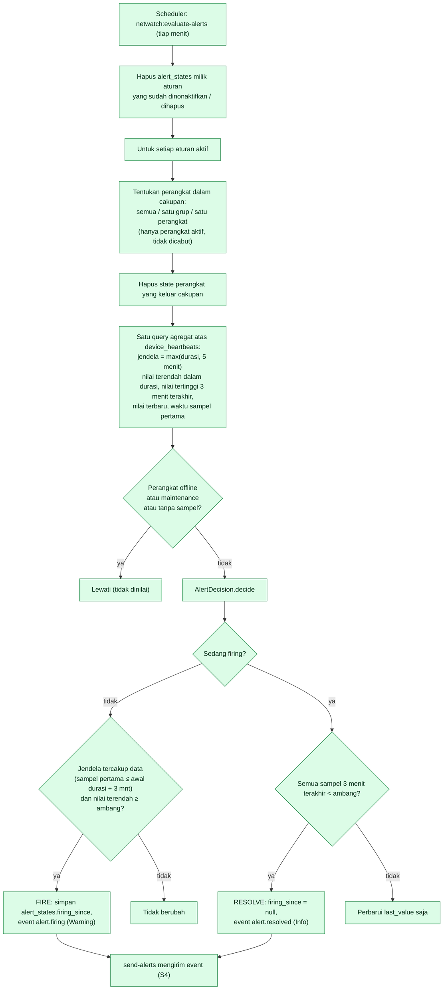

**Aturan keputusan (sengaja konservatif):**
- *Menyala* hanya bila **seluruh** sampel selama `duration_minutes` ≥ ambang **dan** data benar-benar menutupi jendela itu (perangkat yang baru online tidak langsung memicu alert).
- *Pulih* bila semua sampel 3 menit terakhir < ambang (tidak bolak-balik karena satu sampel turun).
- Nilai persentase: CPU = `cpu_percent`; RAM = `used/total`; Disk = `used/total` (`AlertMetric::sqlPercent`).

| Titik | Gejala | Cara cek | Tindakan |
|---|---|---|---|
| Alert tidak pernah menyala | CPU tinggi tapi sunyi | Menu **Alert**: aturan aktif? cakupan benar? `duration_minutes` > lama lonjakan? Perangkat sedang maintenance/offline? Scheduler jalan? | Turunkan durasi; matikan maintenance; cek scheduler |
| Alert menyala lalu padam terus-menerus | Nilai di sekitar ambang | Pulih butuh 3 menit di bawah ambang | Naikkan ambang atau durasi |
| Alert menyala setelah perangkat kembali | Tidak: data jendela harus tercakup | Normal | – |
| Notifikasi tidak terkirim | Event ada, Telegram tidak | Lihat S4 | – |
| Heartbeat dipangkas (14 hari) | Alert dengan durasi > retensi tak mungkin | `NETWATCH_RETENTION_HEARTBEATS` | Durasi aturan harus ≪ 14 hari |

---

## S3. Pemantauan target jaringan (NOC)

**Rujukan:** `netwatch:ping-targets` → `TargetMonitorService`, `SystemTargetProber`, `PingProbe`, `TargetStatusDecider`; UI di `/network` (fitur `network`). Target = switch, AP, printer, server tanpa agent.

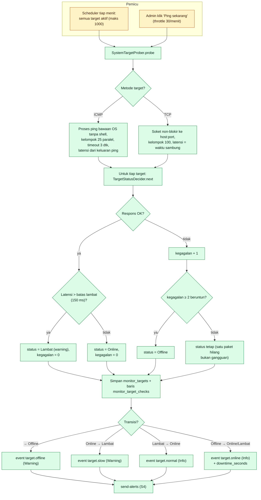

**Aturan validasi target** (saat dibuat/diubah): hanya IP privat/link-local kecuali `NETWATCH_MONITOR_ALLOW_PUBLIC=true`; mengubah alamat/metode mereset status ke "belum dicek".

| Titik | Gejala | Cara cek | Tindakan |
|---|---|---|---|
| Semua target "Belum dicek" | Scheduler mati / NOC dimatikan | `NETWATCH_MONITOR_ENABLED`, menu **Fitur**, `artisan schedule:list` | Aktifkan scheduler |
| Semua target Offline serentak | Server NetWatch yang bermasalah | `ping 8.8.8.8` dari server; `ping` ada di PATH? (`which ping`) | Pasang `iputils-ping`; cek jaringan server |
| `ping` tak bisa dijalankan | Hasil selalu gagal | `which ping`; hak `CAP_NET_RAW`/setuid | Linux: `sudo apt install iputils-ping` |
| Target memblokir ICMP | Offline padahal hidup | Coba metode TCP + port | Ganti metode ke TCP |
| Terlalu sering "Lambat" | Ambang 150 ms terlalu ketat untuk WAN | `NETWATCH_MONITOR_WARN_MS` | Naikkan; notifikasi lambat hanya dikirim bila bertahan 180 dtk |
| Tabel `monitor_target_checks` besar | 1000 target × 1440/hari | Retensi 7 hari | Turunkan `NETWATCH_RETENTION_MONITOR` |
| IP publik ditolak | Pesan validasi | Kebijakan keamanan | `NETWATCH_MONITOR_ALLOW_PUBLIC=true` bila memang perlu |

---

## S4. Pengiriman notifikasi Telegram/email

**Rujukan:** `netwatch:send-alerts` → `AlertDispatcher`, `AlertMessage`, `Alerts/TelegramChannel`, `Alerts/MailChannel`. Dinyalakan dengan `NETWATCH_ALERTS_ENABLED=true` dan minimal satu saluran terisi. Uji dengan `php artisan netwatch:test-alert`.

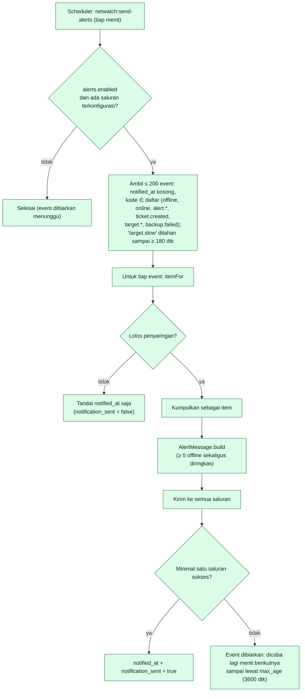

**Aturan penyaringan `itemFor` (alasan pesan "hilang")**

| Jenis event | Dikirim bila… | Dilewati bila… |
|---|---|---|
| `device.offline` | Perangkat aktif, tidak maintenance | Sudah pulih sebelum sempat dikirim (heartbeat baru lebih dari `offline_after` sesudah kejadian); event lebih tua dari `max_age` |
| `device.online` | Kabar offline-nya **benar-benar terkirim** | Offline-nya tidak pernah terkirim (gangguan sesaat) |
| `alert.firing` | Perangkat aktif, tidak maintenance | Maintenance / dicabut |
| `alert.resolved` | `alert.firing` pasangannya sudah terkirim | Pasangan tak terkirim |
| `target.offline` | Selalu (≤ `max_age`) | Terlalu tua |
| `target.slow` | Target masih Lambat dan sudah ≥ 180 dtk terus-menerus | Pulih / offline / dinonaktifkan |
| `target.normal`, `target.online` | Kabar "lambat"/"offline"-nya terkirim | Tidak terkirim |
| `ticket.created`, `backup.failed` | Selalu | Terlalu tua |

| Titik | Gejala | Cara cek | Tindakan |
|---|---|---|---|
| Tidak ada notifikasi sama sekali | Tidak ada saluran aktif | `NETWATCH_ALERTS_ENABLED`, `NETWATCH_TELEGRAM_TOKEN` + `_CHAT_ID`, `NETWATCH_ALERT_MAIL_TO`; `config:cache` ulang setelah ubah `.env` | `php artisan netwatch:test-alert` |
| Telegram error | `errors[]` berisi `telegram: …` | Token salah; bot belum diundang ke grup; chat id grup diawali `-100` | Perbaiki token/chat id |
| Email gagal | `mail: …` | `MAIL_*` di `.env`; `storage/logs/laravel.log` | Uji SMTP; `MAIL_MAILER` bukan `log` |
| Notifikasi telat | Scheduler mati sementara | `max_age_seconds` 3600: event lebih tua dibuang | Pulihkan scheduler |
| "Online" tak pernah dikirim | Offline-nya dulu dilewati | Normal (lihat tabel) | – |
| Notifikasi dobel | Dua scheduler jalan (dua server/cron) | `withoutOverlapping` hanya di satu mesin | Pastikan satu cron |

---

## S5. Alert suara di halaman Jaringan (browser)

**Rujukan:** `public/js/network-alert.js`, `public/js/netwatch.js` (auto-refresh), tampilan `network/index`. Murni di browser: **tidak melibatkan Telegram** dan tidak berjalan bila halaman ditutup.

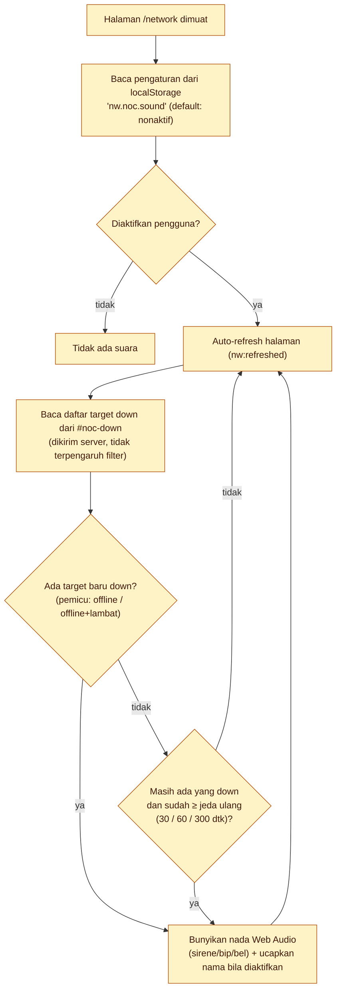

| Titik | Gejala | Cara cek | Tindakan |
|---|---|---|---|
| Tidak ada suara | Browser memblokir audio otomatis | Perlu satu klik di halaman setelah dibuka | Klik tombol uji / halaman sekali |
| Suara berhenti saat tab di latar belakang | Browser menunda timer | Halaman Jaringan tetap me-refresh saat alert suara aktif | Jangan *discard* tab; gunakan mode TV (`?tv=1`) |
| Pengaturan hilang | Mode privat/ganti browser | `localStorage` per browser | Atur ulang di tiap komputer/TV |
| Suara ucapan tak ada | `speechSynthesis` tak didukung | Catatan tampil di panel | Gunakan nada saja |

---

## S6. Tiket bantuan dan penilaian

**Rujukan:** `PublicTicketController`, `PublicTicketRequest`, `TicketService`, `FeedbackService`, `TicketNotifier`, `FeedbackController`. Fitur `tickets` (dapat dimatikan). Dua pintu: pengguna akhir (tanpa login, ikon "Buat Tiket IT") dan petugas (login).

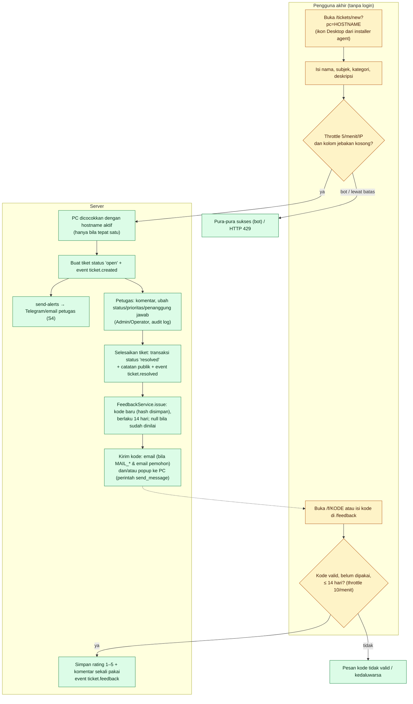

| Titik | Gejala | Cara cek | Tindakan |
|---|---|---|---|
| Halaman tiket tidak terbuka dari PC klien | Timeout / sertifikat | Dari PC itu: `curl -kI https://SERVER/tickets/new`; DNS nama server; CA terpasang di browser | Pastikan nama server resolvable dan CA dipercaya (status: dikerjakan terpisah, lihat `TIKET.md`) |
| 404 | Fitur tiket dimatikan | Menu **Fitur** | Aktifkan |
| Tiket tidak terkait PC | `pc` tak cocok / ganda | Hostname dobel → tidak ditautkan (sengaja) | Perbaiki hostname |
| Email penilaian gagal | Pesan di UI: "Email tidak dikirim …" | `MAIL_MAILER`; email pemohon kosong | Atur `MAIL_*`; gunakan popup/kode manual |
| Popup tidak muncul | Perintah `send_message` tidak diambil | Perangkat offline → `expired` (A5) | Berikan kode secara lisan |
| Kode ditolak | Kedaluwarsa (14 hari) atau sudah dinilai | `ticket_feedback.expires_at/submitted_at` | Terbitkan kode baru (tombol di tiket) |

---

## S7. Backup database

**Rujukan:** `netwatch:backup` → `BackupService`, `PgDumpCommand`, `BackupRetention`. Panduan operasional: [`BACKUP-DATABASE.md`](BACKUP-DATABASE.md).

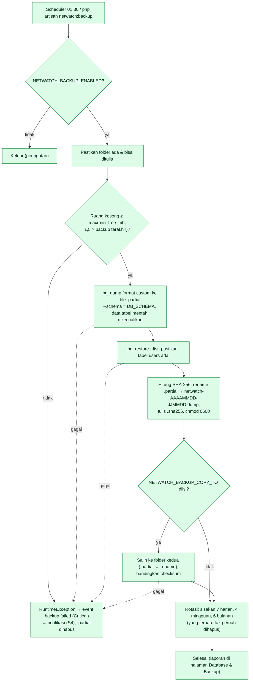

Pesan galat dan tindakannya ada di [`BACKUP-DATABASE.md`](BACKUP-DATABASE.md) bagian "Jika backup gagal". Halaman **Database & Backup** menandai backup basi bila lebih tua dari `NETWATCH_BACKUP_STALE_HOURS` (36 jam).

---

## S8. Retensi data dan rollup

**Rujukan:** `netwatch:prune` (02:30) → `RetentionService`; `netwatch:rollup-bandwidth` (tiap jam menit 05) → `BandwidthRollup`; `BrowsingRollup`.

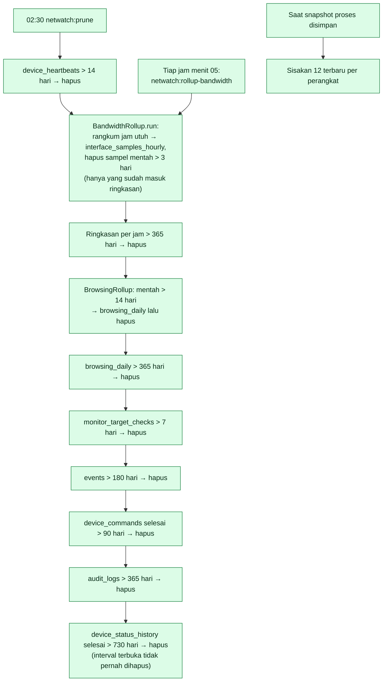

Semua penghapusan dilakukan **per 10.000 baris** agar tidak mengunci tabel lama. Nilai retensi ada di [`KONFIGURASI.md`](KONFIGURASI.md).

| Titik | Gejala | Cara cek | Tindakan |
|---|---|---|---|
| Database membengkak | Tabel besar tidak menyusut | `php artisan netwatch:db-stats`; halaman Database | Pastikan scheduler jalan; `artisan netwatch:prune` manual |
| Grafik bandwidth > 3 hari kosong | Rollup tertinggal | `SELECT max(hour) FROM interface_samples_hourly` | `artisan netwatch:rollup-bandwidth` (maks 14 hari per eksekusi, ulangi) |
| Data browsing mentah lama masih ada | Prune gagal di tengah | Log `laravel.log`; kunci DB | Jalankan ulang; transaksi per 50.000 baris aman diulang |

---

## S9. Laporan uptime dan auto-refresh dashboard

**Rujukan:** `public/js/netwatch.js`, `monitor-ui.js`, `UptimeReportService`, `UptimeCalculator`, `DeviceController::live/liveIndex`, atribut `data-refresh-seconds` / `data-autoreload` / `data-inplace` di `resources/views`.

Ada **tiga mekanisme** pembaruan layar; mengetahui yang mana dipakai sebuah halaman mempercepat diagnosis "angka tidak berubah".

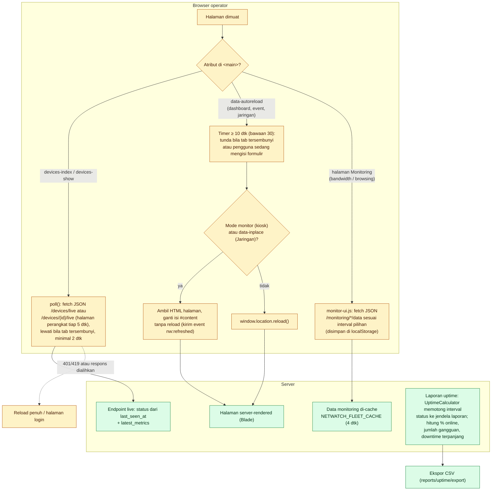

| Titik | Gejala | Cara cek | Tindakan |
|---|---|---|---|
| Angka tidak ter-update | Halaman tampak diam | Teks "Diperbarui … otomatis tiap N detik" di pojok; F12 → Network: respons 401/419/500 | Login ulang; cek `laravel.log` |
| "Pembaruan otomatis ditunda" | Anda sedang mengetik di formulir | Disengaja agar ketikan tidak hilang | Kirim/kosongkan formulir |
| Tab di latar belakang tidak berubah | Browser menunda tab tersembunyi | Halaman Jaringan dengan alert suara tetap diperbarui (`data-refresh-hidden`) | Gunakan mode TV (`?tv=1`) untuk layar monitor |
| Layar penuh keluar sendiri | `reload()` menutup fullscreen | Dipakai refresh in-place di mode kiosk | Gunakan tombol Mode monitor di halaman |
| Dashboard lambat dengan banyak penonton | CPU/DB tinggi | `NETWATCH_FLEET_CACHE` (monitoring); jumlah tab terbuka | Naikkan cache ke 10 dtk; perpanjang interval refresh |
| Uptime 100% padahal ada gangguan | Gangguan saat maintenance? | Riwayat status tetap dicatat selama maintenance | Bandingkan dengan `device_status_history` |
| Uptime rendah di awal periode | Data sebelum enroll tidak dihitung | `UptimeCalculator` memotong ke jendela data | Normal |

---

## S10. Pemeriksaan keamanan

**Rujukan:** `SecurityChecker`, `netwatch:security-check` (kode keluar 1 bila ada yang berisiko). Halaman **Keamanan** (Admin).

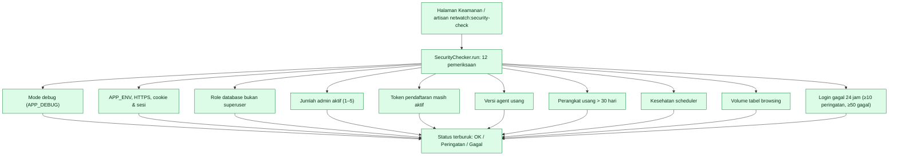

Setiap pemeriksaan memuat pesan dan **saran perbaikan**; tidak ada yang mengubah data. Pemeriksaan "Penjadwal" menandai perangkat yang masih berstatus online padahal `last_seen_at` lebih tua dari 3 × `offline_after` — itu tanda paling andal bahwa **cron tidak berjalan**.

---

## S11. Penjadwal (cron) — peta semua tugas berkala

**Rujukan:** `routes/console.php`. Satu entri cron `* * * * * php artisan schedule:run`.

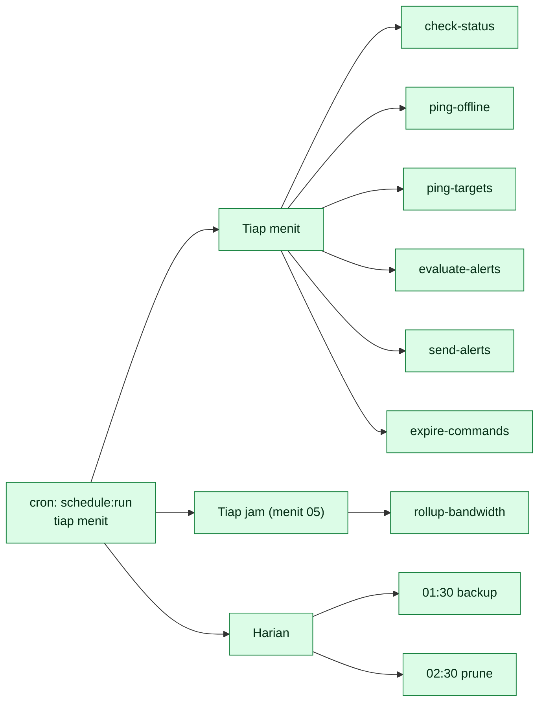

`withoutOverlapping` mencegah eksekusi tumpang tindih (kunci kadaluwarsa: 5 menit untuk ping/alert, 120 menit rollup, 180 menit backup). **Jika scheduler mati**: perangkat yang mati tetap tampil online, notifikasi berhenti, perintah tak kedaluwarsa, backup/retensi berhenti. Tanda utamanya ada di halaman Keamanan (S10).

Rincian tiap perintah ada di [`PERINTAH-DAN-JADWAL.md`](PERINTAH-DAN-JADWAL.md).
