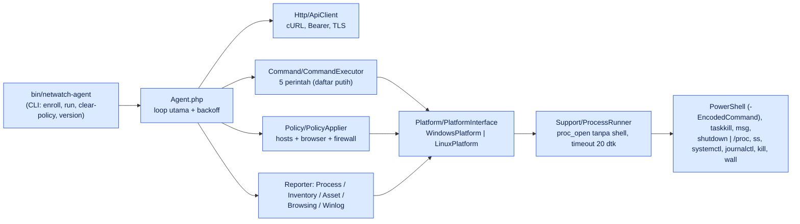

# Agent NetWatch — arsitektur internal dan panduan diagnosis (v1.6.0)

Untuk teknisi yang harus memeriksa **satu PC** yang bermasalah. Dibuat dari kode `agent/` (PHP murni, tanpa dependensi Composer). Alur antar-sistem ada di [`ACTIVITY-DIAGRAM-PERANGKAT.md`](ACTIVITY-DIAGRAM-PERANGKAT.md); kontrak HTTP di [`API-AGENT.md`](API-AGENT.md); pemasangan massal di [`PENYEBARAN-AGENT.md`](PENYEBARAN-AGENT.md).

## 1. Lokasi penting di PC

| Hal | Windows | Linux |
|---|---|---|
| Kode agent | `C:\Program Files\NetWatch\bin\netwatch-agent`, `src\`, PHP portabel di `runtime\php\php.exe` | `/opt/netwatch-agent/` |
| Konfigurasi + **token** | `C:\ProgramData\NetWatch\agent.json` (hanya SYSTEM & Administrators) | `/etc/netwatch-agent/agent.json` (0600) |
| Log agent | `C:\ProgramData\NetWatch\agent.log` (+ `.1` setelah 5 MiB) | `/var/log/netwatch-agent.log` |
| State | `policy-state.json`, `browsing-state.json`, `winlog-state.json` (satu folder dengan `agent.json`) | idem |
| Sertifikat CA | `C:\ProgramData\NetWatch\ca.pem` (bila dibagikan installer) | path di `ca_file` |
| Cara berjalan | Tugas terjadwal **`NetWatchAgent`** (SYSTEM, saat boot, tersembunyi, restart tiap 1 menit hingga 999×) | systemd `netwatch-agent.service` (`Restart=always`, 10 dtk) |
| Pemulihan blokir darurat | `C:\Program Files\NetWatch\install\recover-policy.ps1`, salinan di `C:\ProgramData\NetWatch-Recovery` | – |
| Shortcut tiket | `C:\Users\Public\Desktop\Buat Tiket IT.url` | – |

Isi `agent.json`:

```json
{
  "server_url": "https://netwatch.perusahaan.local",
  "device_id": "<public id>",
  "api_token": "<64 karakter — rahasia>",
  "ca_file": "C:\\ProgramData\\NetWatch\\ca.pem",
  "allow_insecure_http": false,
  "log_file": "C:\\ProgramData\\NetWatch\\agent.log",
  "offline_release_seconds": 600
}
```
`offline_release_seconds = 0` mematikan pelepasan blokir otomatis di luar jaringan kantor.

## 2. Komponen kode



Prinsip desain yang relevan saat troubleshooting:
- **Tanpa shell.** Semua perintah OS dijalankan sebagai larik argumen (`ProcessRunner`); PowerShell dikirim sebagai `-EncodedCommand`. Tidak ada interpolasi string dari server ke perintah.
- **Satu platform, satu antarmuka.** Fungsi yang belum tersedia di Linux (blokir) melempar `PlatformException("… belum didukung di Linux")`.
- **Kegagalan tugas sekunder tidak menjatuhkan agent** (`Agent::guarded`).
- **Tulis atomik** untuk `agent.json` dan state (tulis `.tmp` lalu `rename`).

## 3. Sumber data per fitur

| Data | Windows | Linux |
|---|---|---|
| CPU, RAM, disk, uptime, pengguna | `Get-CimInstance` (Win32_Processor/OperatingSystem/LogicalDisk/ComputerSystem), disk = drive sistem | `/proc/stat` (dua cuplikan), `/proc/meminfo`, `/proc/uptime` |
| Interface jaringan (counter) | PowerShell | `/proc/net/dev` (loopback & virtual docker/veth/bridge dilewati) |
| Proses | PowerShell (`PROCESSES_SCRIPT`) | `ps -eo pid=,user:32=,rss=,cputimes=,comm=` |
| Port listen + layanan | `Get-NetTCPConnection -State Listen`, `Win32_Service` | `ss`, `systemctl list-units/list-unit-files` |
| Koneksi aktif (browsing) | `Get-NetTCPConnection -State Established` | `ss -H -t -n -p state established` |
| Riwayat browser | SQLite `History` Chrome/Edge di `C:\Users\*\AppData\Local\…\User Data\{Default,Profile N}` (butuh `pdo_sqlite`) | `/home/*/.config/{google-chrome,chromium,microsoft-edge}/{Default,Profile N}/History` |
| Aset perangkat keras | `Win32_ComputerSystem/BIOS/OperatingSystem/Processor/DiskDrive` | `/proc/cpuinfo`, `/proc/meminfo`, `lsblk` |
| Program terpasang | registry `Uninstall` 64/32-bit (tanpa komponen sistem & pembaruan) | `dpkg-query` atau `rpm -qa` |
| Event log | `Get-WinEvent` (System/Application; Level 1–2 semua penyedia, Level 3 penyedia jaringan/hardware tertentu) | `journalctl -p err -o json` |
| Akhiri proses | `taskkill /PID n /F` | `kill -TERM n` |
| Pesan ke pengguna | `msg * /TIME:60 "pesan"` (tidak ada di edisi Windows Home) | `wall` |
| Restart / shutdown | `shutdown /r|/s` dengan jeda | `shutdown -r|-h +menit` |
| Blokir domain/IP | `hosts`, kebijakan `URLBlocklist` Chrome/Edge (registry HKLM), aturan Windows Firewall untuk IP | **belum didukung** |

## 4. Perintah CLI

```text
netwatch-agent enroll --server=URL (--token=T | --token-file=PATH) [--config=PATH] [--ca-file=PATH] [--allow-insecure-http]
netwatch-agent run    [--config=PATH] [--verbose]      # --verbose: log juga ke layar (uji manual)
netwatch-agent clear-policy [--config=PATH]            # bersihkan semua blokir NetWatch (dipakai saat uninstall)
netwatch-agent version
```
Pengujian manual di PC (PowerShell Administrator, **hentikan tugas dulu agar tidak dobel**):

```powershell
schtasks /End /TN NetWatchAgent
& "C:\Program Files\NetWatch\runtime\php\php.exe" "C:\Program Files\NetWatch\bin\netwatch-agent" run --verbose
# Ctrl+C untuk berhenti, lalu:
schtasks /Run /TN NetWatchAgent
```

## 5. Jadwal internal

| Tugas | Interval | Syarat |
|---|---|---|
| Heartbeat + perintah + policy | `heartbeat_interval` dari server (5–3600 dtk, bawaan 30) | selalu |
| Snapshot proses | `process_snapshot_interval` (bawaan 300 dtk) | selalu |
| Browsing | 120 dtk | `browsing_enabled` dari server |
| Inventaris port/layanan | 600 dtk (mulai 15 dtk setelah start) | – |
| Aset keras/lunak | 300 dtk (mulai 20 dtk) | – |
| Winlog | 300 dtk (mulai 30 dtk) | `winlog_enabled` |
| Verifikasi policy terpasang | 300 dtk | policy aktif |
| Backoff saat gagal | `min(60, interval × 2^n)` + jitter 20% | galat non-401/403 |

## 6. Daftar putih perintah dan proses terlindungi

Perintah yang dikenali (`CommandExecutor`): `refresh_processes`, `terminate_process`, `send_message`, `restart_computer`, `shutdown_computer`. Tipe lain → `failed` dengan pesan *Tipe perintah tidak dikenal*. `terminate_process` menolak: `pid < 2`, proses terlindungi (`system`, `smss`, `csrss`, `wininit`, `winlogon`, `services`, `lsass`, `dwm`, `init`, `systemd`, `sshd`, `php`, `netwatch-agent`, …), proses agent sendiri, dan **PID yang sudah berganti pemilik** (nama proses sekarang ≠ nama yang dipilih operator).

## 7. Mekanisme policy blokir (ringkas)

1. Server mengirim `{domains[], ips[], hash}` hanya bila hash terpasang ≠ hash server.
2. Agent memvalidasi (`BlockPolicy::fromArray`) dan **menolak** bila memuat host server NetWatch sendiri.
3. `verify()` membaca kondisi nyata: domain di `hosts` harus sama dengan domain di registry browser, plus IP di firewall → hash aktual.
4. `applyBlockPolicy`: tulis blok bertanda di `hosts`; tulis `URLBlocklist` Chrome/Edge (hanya entri milik NetWatch; entri GPO/MDM tidak disentuh); aturan firewall IP.
5. Verifikasi ulang; sukses → `policy-state.json` (hash). Gagal → simpan galat, dicoba lagi paling cepat 5 menit untuk hash yang sama.
6. Server tak terjangkau ≥ `offline_release_seconds` → blokir dilepas; terpasang kembali saat server terjangkau dan meminta policy.

Detail fitur: [`BLOKIR.md`](BLOKIR.md).

## 8. Tabel gejala di PC → penyebab → tindakan

| Gejala | Kemungkinan penyebab | Cara cek | Tindakan |
|---|---|---|---|
| PC tak muncul di dashboard | Enroll gagal / token salah | `agent.log` ("Pendaftaran gagal"); ada `agent.json`? | Ulangi enroll dengan token baru |
| Online sebentar lalu offline | Agent berhenti (401) / tugas tak restart | `agent.log`, `schtasks /Query /TN NetWatchAgent /V` | Daftar ulang; periksa pencabutan |
| Tugas `NetWatchAgent` "Ready" tetapi tak jalan | Dimatikan GPO/antivirus; PHP diblokir | Event Viewer Windows → Task Scheduler; antivirus quarantine `php.exe` | Whitelist `C:\Program Files\NetWatch`; `schtasks /Run` |
| `Tidak dapat terhubung ke server` | DNS/firewall/proxy | `Test-NetConnection SERVER -Port 443` | Perbaiki jaringan; cek `server_url` |
| `SSL certificate problem` | CA internal tidak dipercaya agent | Ada `ca_file`? | Salin `ca.pem`, isi `ca_file`, restart tugas |
| `Respons server bukan JSON` | Reverse proxy mengembalikan HTML (login portal/captive) | `curl` dari PC (lihat API-AGENT §4) | Perbaiki proxy |
| Waktu salah | Jam PC jauh | `w32tm /query /status` | `w32tm /resync` |
| `powershell.exe` galat | Kebijakan PowerShell/Constrained Language | `agent.log` memuat keluaran | Izinkan PowerShell untuk SYSTEM |
| `msg.exe tidak tersedia` | Windows Home | Disengaja | Perintah pesan tidak didukung di edisi itu |
| Peringatan `pdo_sqlite tidak ada` | Runtime PHP lama | `agent.log` | Pasang ulang dari installer terbaru |
| Tidak bisa dibuka setelah uninstal | Folder sisa | Lihat A11 di diagram | `recover-policy.ps1` |
| CPU agent tinggi | Banyak proses/port; PowerShell lambat | `agent.log` jeda panjang | Naikkan interval; laporkan versi + ukuran inventaris |

## 9. Pengujian agent (pengembang)

`agent/tests/run.php` berisi uji mandiri tanpa framework (sanitizer URL, kursor winlog, hosts, policy, executor, dll.). Jalankan: `php agent/tests/run.php`. Pada penyusunan dokumen ini: **107 uji lulus, 0 gagal** (dijalankan di sandbox dengan PHP CLI).
