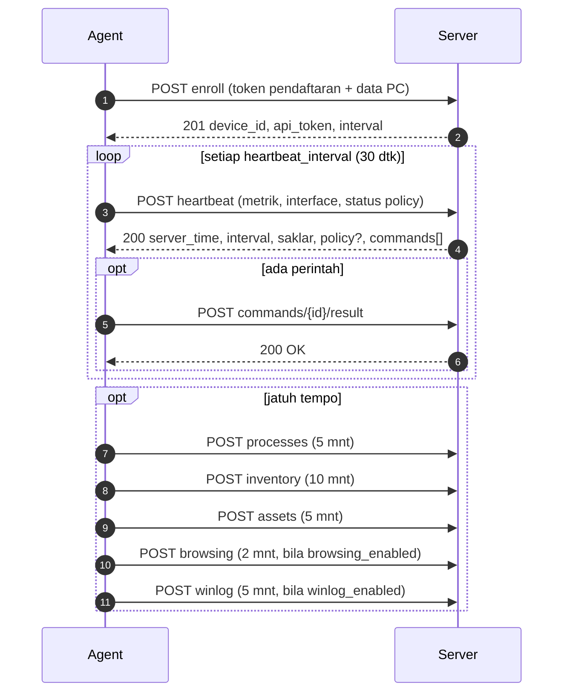

# API Agent ↔ Server (v1)

Kontrak HTTP antara agent di PC klien dan server NetWatch. Dibuat dari `server/routes/api.php`, `app/Http/Requests/Api/*`, `app/Http/Controllers/Api/Agent/*`, `AuthenticateAgent`, dan klien `agent/src/Http/ApiClient.php`. Pakai dokumen ini untuk **mereproduksi masalah dengan `curl`**, memeriksa isi kiriman, dan membaca arti kode status.

Alur bergambar ada di [`ACTIVITY-DIAGRAM-PERANGKAT.md`](ACTIVITY-DIAGRAM-PERANGKAT.md); struktur tabel di [`KAMUS-DATA.md`](KAMUS-DATA.md).

## 1. Ketentuan umum

| Hal | Nilai |
|---|---|
| Alamat dasar | `https://SERVER/api/agent/v1/` (agent: `ApiClient::API_PREFIX = /api/agent/v1/`) |
| Metode | Semua `POST`, isi **JSON** (`Content-Type: application/json`, `Accept: application/json`) |
| Autentikasi | `Authorization: Bearer <api_token>` (64 karakter) — kecuali `enroll` yang memakai token pendaftaran di badan permintaan |
| Penyimpanan token di server | Hanya **hash SHA-256**; token asli hanya ada di `agent.json` PC dan di respons enroll (sekali) |
| Transport | HTTPS wajib (agent menolak `http://` kecuali `allow_insecure_http`); redirect **tidak diikuti** |
| Batas waktu agent | koneksi 5 dtk, total 20 dtk, respons maks 2 MiB |
| Format galat | `{"message": "..."}`; validasi 422: `{"message": "...", "errors": {"kolom": ["..."]}}` |
| Pembatas laju | `enroll` 10/menit per IP; sisanya 240/menit **per token** (`agent-api`) |



## 2. Kode status

| Kode | Arti | Penyebab umum | Perilaku agent |
|---|---|---|---|
| 200 | OK (`heartbeat`, `commands/*/result`) | – | lanjut |
| 201 | Dibuat (`enroll`, `processes`, `inventory`, `assets`, `browsing`, `winlog`) | – | lanjut |
| 401 | `{"message":"Unauthenticated."}` | Token kosong, panjang ≠ 64, hash tidak dikenal, atau perangkat **dicabut** | **Agent berhenti** (token ditolak) |
| 403 | Enroll: `Token pendaftaran tidak valid atau sudah kedaluwarsa.` | Token pendaftaran salah/kedaluwarsa/habis/dicabut | Enroll gagal; kode keluar 1 |
| 404 | `commands/{id}/result`: perintah bukan milik perangkat ini | `id` salah/milik perangkat lain | Dicatat, tidak diulang |
| 409 | `commands/{id}/result`: `Perintah ini tidak sedang menunggu hasil.` | Perintah sudah selesai/kedaluwarsa | Dicatat, tidak diulang |
| 422 | Validasi gagal | Lihat tabel kolom di bawah | Dicatat; coba lagi siklus berikutnya |
| 429 | Pembatas laju | Terlalu sering | Backoff |
| 5xx | Galat server | `storage/logs/laravel.log` | Backoff (maks ±72 dtk) |
| 0 (klien) | Tidak tersambung | DNS/firewall/TLS | Backoff; bila ≥ `offline_release_seconds` (600) blokir dilepas |

## 3. Endpoint

### 3.1 `POST enroll`
Mendaftarkan PC. Tanpa Bearer.

| Kolom | Aturan |
|---|---|
| `enrollment_token` | wajib, string, **tepat 64**, alfanumerik |
| `hostname` | wajib, ≤ 255, regex `^[A-Za-z0-9][A-Za-z0-9._-]*$` |
| `os_family` | wajib, `windows` atau `linux` |
| `os_version` | opsional, ≤ 100 |
| `agent_version` | wajib, ≤ 20 |
| `ip_address` | opsional, IP valid |
| `mac_address` | opsional, MAC valid |

Respons **201**:
```json
{ "device_id": "<public id>", "api_token": "<64 karakter>", "heartbeat_interval": 30, "process_snapshot_interval": 300 }
```
Hostname aktif yang sama didaftarkan ulang (perangkat yang sama; token lama langsung tidak berlaku).

### 3.2 `POST heartbeat`
Denyut utama. Menandai online, menyimpan metrik, mengambil perintah dan policy.

| Kolom | Aturan |
|---|---|
| `agent_version` | opsional, ≤ 20 |
| `metrics.cpu_percent` | wajib, 0–100 |
| `metrics.memory_used_mb`, `memory_total_mb` | wajib, integer ≥ 0 |
| `metrics.disk_used_gb`, `disk_total_gb` | wajib, integer ≥ 0 |
| `metrics.uptime_seconds` | wajib, integer ≥ 0 |
| `metrics.logged_in_user` | opsional, ≤ 255 |
| `policy.hash` | opsional, 64 alfanumerik (hash kebijakan yang **terpasang**) |
| `policy.error` | opsional, ≤ 500 |
| `policy.offline_release` | opsional, boolean |
| `interfaces[]` (maks 32) | `name` (wajib ≤ 100), `rx_bytes`, `tx_bytes` (wajib int ≥ 0, **counter kumulatif**), `speed_bps` (opsional) |

Respons **200**:
```json
{
  "server_time": "2026-10-30T06:00:00+00:00",
  "heartbeat_interval": 30,
  "process_snapshot_interval": 300,
  "browsing_enabled": false,
  "winlog_enabled": false,
  "policy": { "...": "hanya bila hash berbeda (Windows)" },
  "commands": [ { "id": "<public id>", "type": "terminate_process", "payload": { "pid": 1234, "process_name": "notepad.exe" } } ]
}
```
`commands` berisi maksimal 10 perintah yang baru berubah `pending → dispatched`.

### 3.3 `POST processes`
`processes` (wajib, maks 5000): `pid` (int ≥ 0), `name` (≤ 255), `cpu_seconds` (opsional ≥ 0), `memory_mb` (opsional ≥ 0), `user` (opsional ≤ 255). Server menyimpan maksimal 500 dan menyisakan 12 snapshot per perangkat. Respons 201: `{"process_count": N}`.

### 3.4 `POST inventory`
`ports` (wajib, maks 3000): `protocol` (≤ 3), `address` (≤ 64), `port` (int), `process` (opsional ≤ 260). `services` (wajib, maks 1500): `name`, `display`, `state`, `start`. Respons 201 `{"ports": n, "services": n}` atau `{"skipped": true}` bila fitur Inventaris dimatikan.

### 3.5 `POST assets`
`hardware` (**wajib hadir**, boleh `null` = gagal baca → data lama dipertahankan): `manufacturer`, `model`, `serial`, `cpu`, `cpu_cores`, `cpu_threads`, `memory_mb`, `os`, `os_version`, `os_build`, `disks[]` (maks 16; `model`, `size_gb`). `software` (wajib hadir, boleh `null`, maks 3000): `name` (wajib ≤ 300), `version`, `publisher`, `installed` (`Y-m-d`). Respons 201 `{"software": n, "hardware_changed": bool}` atau `{"skipped": true}`.

### 3.6 `POST browsing`
`visits` (wajib, maks 500): `kind` (`url`/`connection`), `at` (waktu ISO), `host`, `ip`, `port`, `url` (≤ 2048), `process`, `browser`. Respons 201 `{"stored", "rejected", "ignored", "over_limit"}`; bila fitur mati: 200 `{"stored":0,"rejected":0}`.

### 3.7 `POST winlog`
`events` (wajib, maks 200): `log` (`System`/`Application`), `provider`, `id`, `level` (1–3), `time` (unix), `record`, `message` (≤ 1000), `count`. Server menolak kejadian di luar umur 7 hari / lebih dari 5 menit di masa depan, dan menghapus duplikat (`log|record`). Respons 201 `{"stored", "skipped"}`; bila fitur mati: `{"stored":0,"skipped":0}`.

### 3.8 `POST commands/{id}/result`
`id` = `public_id` perintah dari respons heartbeat.

| Kolom | Aturan |
|---|---|
| `status` | wajib, `succeeded` atau `failed` |
| `result` | opsional, objek |
| `error` | opsional, ≤ 2000 |

Respons 200 `{"message":"OK"}`; 404 bila bukan milik perangkat; 409 bila status bukan `dispatched`.

## 4. Mereproduksi dengan `curl`

> Jalankan dari server atau PC klien. Ganti `SERVER`, `TOKEN`. Tambahkan `-k` **hanya** untuk uji bila memakai CA internal (lebih baik `--cacert ca.pem`). **Jangan** menempelkan token asli ke tiket/chat.

```bash
# 1. Cek server menjawab (harus 401 JSON, bukan HTML/timeout)
curl -sS -o /dev/null -w "%{http_code}\n" -X POST https://SERVER/api/agent/v1/heartbeat -H "Accept: application/json"

# 2. Heartbeat minimal
curl -sS -X POST https://SERVER/api/agent/v1/heartbeat \
  -H "Authorization: Bearer TOKEN" -H "Content-Type: application/json" -H "Accept: application/json" \
  -d '{"metrics":{"cpu_percent":12.5,"memory_used_mb":2048,"memory_total_mb":8192,"disk_used_gb":120,"disk_total_gb":256,"uptime_seconds":3600}}'

# 3. Enroll (token pendaftaran 64 karakter)
curl -sS -X POST https://SERVER/api/agent/v1/enroll -H "Content-Type: application/json" -H "Accept: application/json" \
  -d '{"enrollment_token":"<64 karakter>","hostname":"PC-UJI-01","os_family":"windows","agent_version":"1.6.0"}'
```

| Hasil | Berarti |
|---|---|
| `401 {"message":"Unauthenticated."}` pada heartbeat tanpa token | Normal; server dan route hidup |
| HTML / 404 Nginx | Rute `/api` tidak diteruskan ke PHP-FPM (`try_files` Nginx) |
| `419` | Anda memanggil rute web, bukan `/api/agent/v1` |
| Timeout / `SSL certificate problem` | Firewall, DNS, atau CA belum dipercaya |
| `422` dengan `errors` | Perbaiki kolom yang disebut |
| `200` dengan `commands: []` | Semua baik |

## 5. Memeriksa dari sisi database (read-only)

```sql
-- Heartbeat terakhir perangkat
SELECT recorded_at, cpu_percent, memory_used_mb FROM device_heartbeats
 WHERE device_id = (SELECT id FROM devices WHERE hostname = 'PC-UJI-01') ORDER BY recorded_at DESC LIMIT 5;
-- Apakah token cocok? (hash SHA-256 dari token, hex)
SELECT id, hostname, revoked_at, last_seen_at FROM devices WHERE token_hash = encode(sha256('TOKEN'::bytea), 'hex');
```
Bila memakai schema terpisah (`DB_SCHEMA=netwatch`), awali nama tabel dengan `netwatch.` atau jalankan `SET search_path TO netwatch;` dulu.
