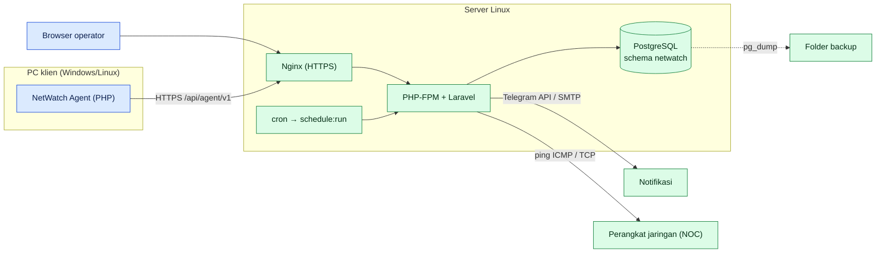

# Arsitektur NetWatch

## 1. Komponen



Arah koneksi: agent **selalu** yang memulai (server tidak pernah menghubungi PC). Perintah dari dashboard menunggu heartbeat berikutnya.

## 2. Alur permintaan

| Jenis | Rute | Middleware | Pengendali |
|---|---|---|---|
| API agent | `routes/api.php` prefix `/api/agent/v1` | `agent` (token) + `throttle:agent-api` | `Http/Controllers/Api/Agent/*` |
| Dashboard | `routes/web.php` | `auth`, `active`, `can:*`, `feature:*`, header keamanan | `Http/Controllers/Web/*` |
| Halaman publik | `/tickets/new`, `/f/{kode}`, `/feedback` | `feature:tickets`, throttle per IP | `PublicTicketController`, `FeedbackController` |
| Terjadwal | `routes/console.php` | – | `Console/Commands/*` |

Lapisan: **Controller → FormRequest (validasi) → Service (logika) → Model/DB**. Logika murni yang mudah diuji ada di `app/Support/*` (mis. `AlertDecision`, `TargetStatusDecider`, `BandwidthMath`, `UptimeCalculator`).

## 3. Peta fitur → kode → tabel

| Fitur | Service utama | Tabel utama |
|---|---|---|
| Enrollment & token | `EnrollmentService`, `TokenService` | `enrollment_tokens`, `devices` |
| Heartbeat & metrik | `HeartbeatService`, `StatusTracker` | `device_heartbeats`, `devices`, `device_status_history` |
| Perintah | `CommandService` | `device_commands` |
| Task manager | `ProcessSnapshotService` | `process_snapshots` |
| Policy blokir | `PolicyBuilder`, `PolicySync`, `BlockRuleGuard` | `policies`, `block_rules` |
| Bandwidth | `BandwidthRecorder`, `BandwidthRollup` | `device_interfaces`, `interface_samples(_hourly)` |
| Browsing | `BrowsingRecorder`, `BrowsingRollup` | `browsing_visits`, `browsing_daily`, `browsing_ignored_hosts` |
| Inventaris | `InventoryRecorder`, `AssetRecorder` | `device_ports`, `device_services`, `device_hardware`, `device_software` |
| Event Log/Event | `EventRecorder`, `WinlogRecorder` | `events` |
| Alert ambang | `AlertEvaluator` | `alert_rules`, `alert_states` |
| Notifikasi | `AlertDispatcher`, `Alerts/*Channel` | `events.notified_at` |
| NOC | `TargetMonitorService` | `monitor_targets`, `monitor_target_checks` |
| Tiket | `TicketService`, `FeedbackService` | `tickets`, `ticket_comments`, `ticket_feedback` |
| Backup/DB | `BackupService`, `DatabaseHealthService` | (semua) |
| Keamanan/Audit | `SecurityChecker`, `AuditLogger` | `audit_logs` |
| Saklar fitur | `FeatureFlags` | `feature_flags` |

Struktur kolom lengkap: [`KAMUS-DATA.md`](KAMUS-DATA.md); relasi: [`ERD.md`](ERD.md).

## 4. Peta direktori

```text
netwatch/
├─ server/        Laravel: app/{Console,Enums,Http,Models,Services,Support,Alerts}, config/netwatch.php,
│                 database/migrations, resources/views, public/{js,css}, routes/, tests/
├─ agent/         bin/, src/{Platform,Policy,Browsing,Winlog,Inventory,Command,Http,...}, install/, installer/, tests/run.php
├─ deploy/        nginx, logrotate, cron
├─ docs/          dokumentasi (dokumen ini)
└─ RELEASE.txt, README.md
```

## 5. Lokasi log

| Log | Lokasi |
|---|---|
| Aplikasi Laravel | `server/storage/logs/laravel.log` |
| Nginx | `/var/log/nginx/error.log`, `access.log` |
| PHP-FPM | `/var/log/php8.x-fpm.log` |
| Scheduler/cron | `/var/log/syslog` (grep CRON) |
| PostgreSQL | `/var/log/postgresql/` |
| Agent Windows / Linux | `C:\ProgramData\NetWatch\agent.log` / `/var/log/netwatch-agent.log` |
| Aktivitas pengguna | menu **Audit Log** (tabel `audit_logs`); kejadian sistem di menu **Event** |
