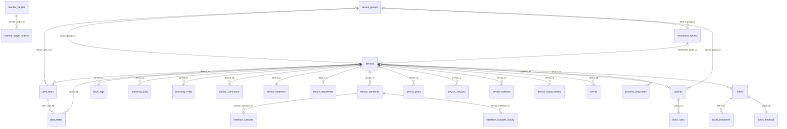
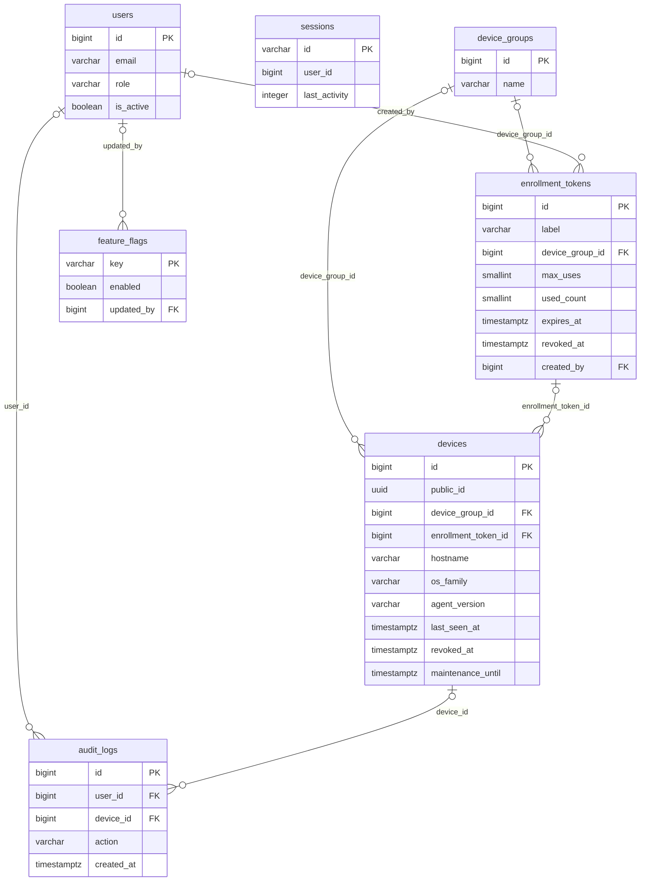
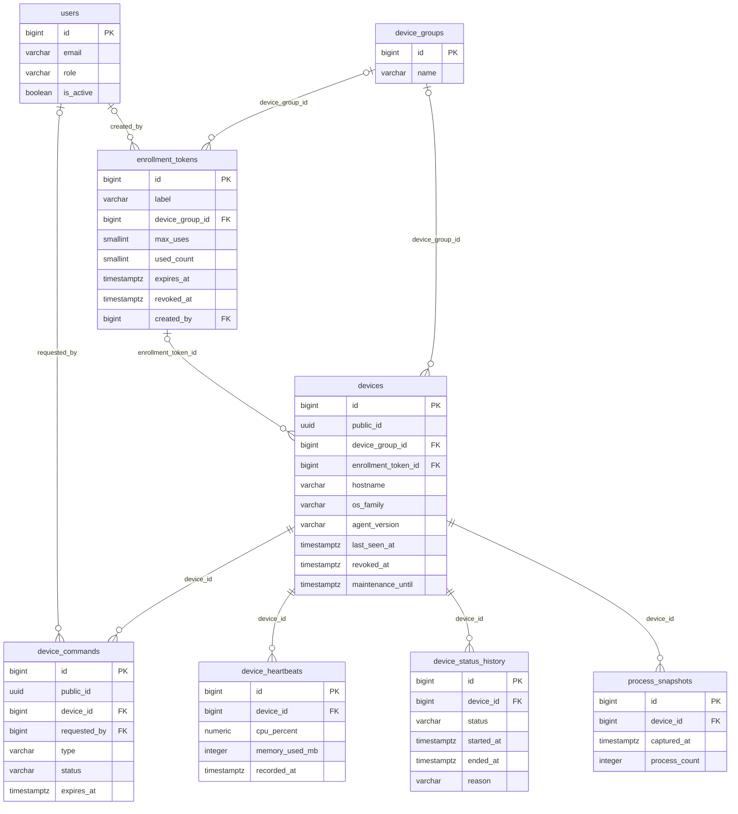
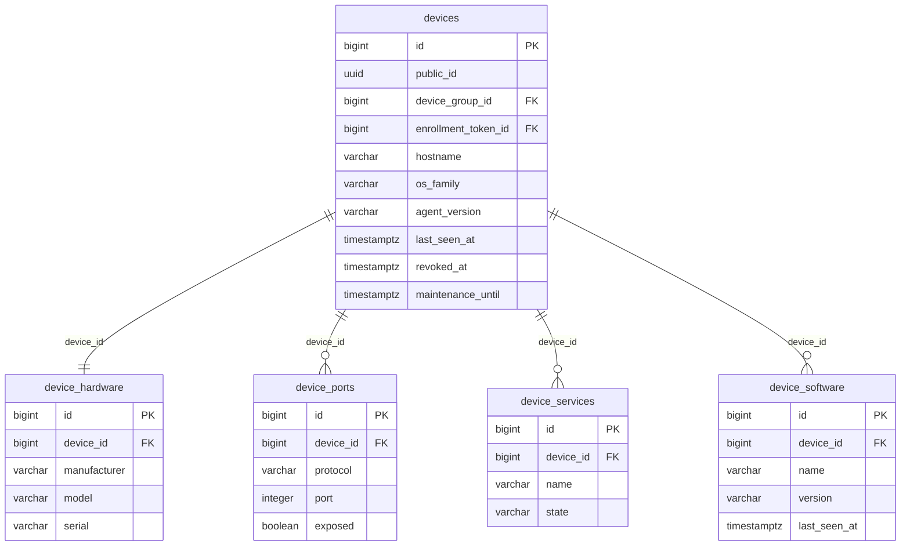
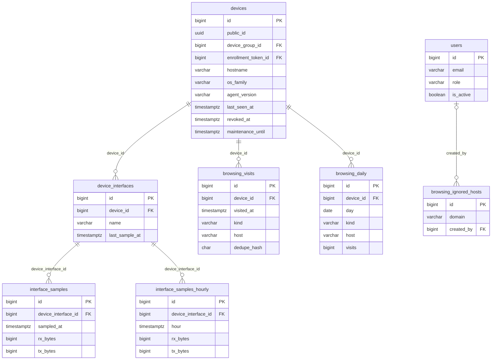
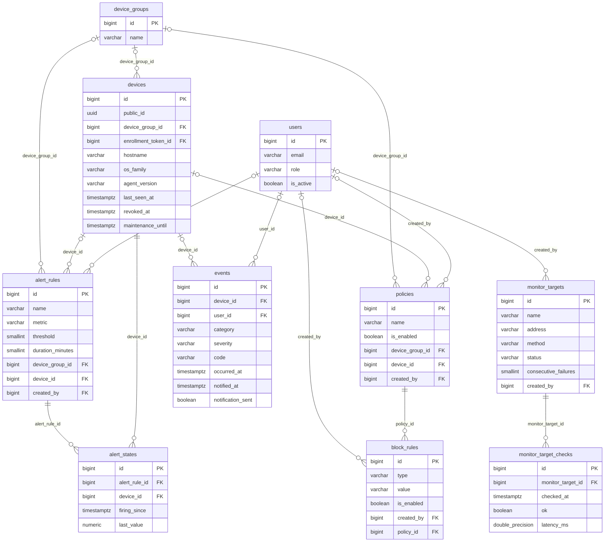
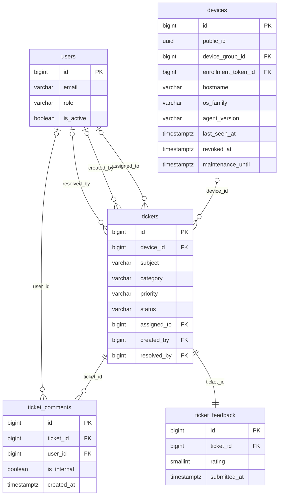

# ERD (Entity Relationship Diagram) NetWatch

Dokumen ini menggambarkan struktur basis data **keadaan akhir setelah seluruh 27 migrasi dijalankan** (31 tabel). Sumber: `server/database/migrations/*.php` dan relasi Eloquent di `server/app/Models/`. Kolom, tipe, dan indeks lengkap per tabel ada di `docs/KAMUS-DATA.md`; skema referensi lama `docs/schema.sql` hanya pembanding (bisa tertinggal dari migrasi).

Cara membaca notasi (crow's foot): `||` tepat satu, `|o` nol atau satu, `o{` nol atau banyak. Contoh `devices ||--o{ device_heartbeats` = satu perangkat punya banyak heartbeat; `device_groups |o--o{ devices` = grup boleh tidak ada (kolom FK boleh NULL).

Daftar isi: [1. Ikhtisar](#1-ikhtisar-seluruh-relasi) · [2. Diagram per domain](#2-diagram-per-domain) · [3. Daftar relasi](#3-daftar-relasi-foreign-key) · [4. Relasi tanpa foreign key](#4-relasi-logis-tanpa-foreign-key) · [5. Dampak penghapusan](#5-dampak-penghapusan-data) · [6. Catatan teknis](#6-catatan-teknis)

## 1. Ikhtisar seluruh relasi

Hanya relasi (tanpa kolom) agar seluruh tabel muat dalam satu gambar. Relasi ke `users` (kolom `created_by`, `requested_by`, `assigned_to`, `resolved_by`, `user_id`, `updated_by`) **tidak digambar** karena hampir semua tabel menunjuk ke sana dan membuat gambar tak terbaca; lihat tabel di bagian 3 dan diagram per domain. Tabel `sessions` tidak punya foreign key (bagian 4).

## 2. Diagram per domain

Menampilkan kolom kunci (PK, FK) dan kolom yang paling sering dipakai saat troubleshooting. Tabel dari domain lain yang menjadi induk ikut digambar tanpa kolom detail bila perlu.

### 2.1 Identitas, akses, dan pengaturan

Tabel induk dari domain lain yang ikut digambar: `devices`.

### 2.2 Perangkat dan telemetri

Tabel induk dari domain lain yang ikut digambar: `users`, `device_groups`, `enrollment_tokens`.

### 2.3 Inventaris perangkat

Tabel induk dari domain lain yang ikut digambar: `devices`.

### 2.4 Bandwidth dan riwayat browsing

Tabel induk dari domain lain yang ikut digambar: `devices`, `users`.

### 2.5 Policy, alert, event, dan jaringan (NOC)

Tabel induk dari domain lain yang ikut digambar: `device_groups`, `devices`, `users`.

### 2.6 Tiket dan penilaian layanan

Tabel induk dari domain lain yang ikut digambar: `users`, `devices`.

## 3. Daftar relasi (foreign key)

Semua relasi di bawah adalah foreign key sungguhan di PostgreSQL. "Wajib" berarti kolom NOT NULL.

| Tabel anak | Kolom | Tabel induk | Kardinalitas | Wajib? | ON DELETE |
|---|---|---|---|---|---|
| `alert_rules` | `created_by` | `users.id` | 1 : banyak | tidak (boleh NULL) | SET NULL |
| `alert_rules` | `device_group_id` | `device_groups.id` | 1 : banyak | tidak (boleh NULL) | CASCADE |
| `alert_rules` | `device_id` | `devices.id` | 1 : banyak | tidak (boleh NULL) | CASCADE |
| `alert_states` | `alert_rule_id` | `alert_rules.id` | 1 : banyak | ya | CASCADE |
| `alert_states` | `device_id` | `devices.id` | 1 : banyak | ya | CASCADE |
| `audit_logs` | `device_id` | `devices.id` | 1 : banyak | tidak (boleh NULL) | SET NULL |
| `audit_logs` | `user_id` | `users.id` | 1 : banyak | tidak (boleh NULL) | SET NULL |
| `block_rules` | `created_by` | `users.id` | 1 : banyak | tidak (boleh NULL) | SET NULL |
| `block_rules` | `policy_id` | `policies.id` | 1 : banyak | ya | CASCADE |
| `browsing_daily` | `device_id` | `devices.id` | 1 : banyak | ya | CASCADE |
| `browsing_ignored_hosts` | `created_by` | `users.id` | 1 : banyak | tidak (boleh NULL) | SET NULL |
| `browsing_visits` | `device_id` | `devices.id` | 1 : banyak | ya | CASCADE |
| `device_commands` | `device_id` | `devices.id` | 1 : banyak | ya | CASCADE |
| `device_commands` | `requested_by` | `users.id` | 1 : banyak | tidak (boleh NULL) | SET NULL |
| `device_hardware` | `device_id` | `devices.id` | 1 : 0..1 | ya | CASCADE |
| `device_heartbeats` | `device_id` | `devices.id` | 1 : banyak | ya | CASCADE |
| `device_interfaces` | `device_id` | `devices.id` | 1 : banyak | ya | CASCADE |
| `device_ports` | `device_id` | `devices.id` | 1 : banyak | ya | CASCADE |
| `device_services` | `device_id` | `devices.id` | 1 : banyak | ya | CASCADE |
| `device_software` | `device_id` | `devices.id` | 1 : banyak | ya | CASCADE |
| `device_status_history` | `device_id` | `devices.id` | 1 : banyak | ya | CASCADE |
| `devices` | `device_group_id` | `device_groups.id` | 1 : banyak | tidak (boleh NULL) | SET NULL |
| `devices` | `enrollment_token_id` | `enrollment_tokens.id` | 1 : banyak | tidak (boleh NULL) | SET NULL |
| `enrollment_tokens` | `created_by` | `users.id` | 1 : banyak | tidak (boleh NULL) | SET NULL |
| `enrollment_tokens` | `device_group_id` | `device_groups.id` | 1 : banyak | tidak (boleh NULL) | SET NULL |
| `events` | `device_id` | `devices.id` | 1 : banyak | tidak (boleh NULL) | SET NULL |
| `events` | `user_id` | `users.id` | 1 : banyak | tidak (boleh NULL) | SET NULL |
| `feature_flags` | `updated_by` | `users.id` | 1 : banyak | tidak (boleh NULL) | SET NULL |
| `interface_samples` | `device_interface_id` | `device_interfaces.id` | 1 : banyak | ya | CASCADE |
| `interface_samples_hourly` | `device_interface_id` | `device_interfaces.id` | 1 : banyak | ya | CASCADE |
| `monitor_target_checks` | `monitor_target_id` | `monitor_targets.id` | 1 : banyak | ya | CASCADE |
| `monitor_targets` | `created_by` | `users.id` | 1 : banyak | tidak (boleh NULL) | SET NULL |
| `policies` | `created_by` | `users.id` | 1 : banyak | tidak (boleh NULL) | SET NULL |
| `policies` | `device_group_id` | `device_groups.id` | 1 : banyak | tidak (boleh NULL) | CASCADE |
| `policies` | `device_id` | `devices.id` | 1 : banyak | tidak (boleh NULL) | CASCADE |
| `process_snapshots` | `device_id` | `devices.id` | 1 : banyak | ya | CASCADE |
| `ticket_comments` | `ticket_id` | `tickets.id` | 1 : banyak | ya | CASCADE |
| `ticket_comments` | `user_id` | `users.id` | 1 : banyak | tidak (boleh NULL) | SET NULL |
| `ticket_feedback` | `ticket_id` | `tickets.id` | 1 : 0..1 | ya | CASCADE |
| `tickets` | `assigned_to` | `users.id` | 1 : banyak | tidak (boleh NULL) | SET NULL |
| `tickets` | `created_by` | `users.id` | 1 : banyak | tidak (boleh NULL) | SET NULL |
| `tickets` | `device_id` | `devices.id` | 1 : banyak | tidak (boleh NULL) | SET NULL |
| `tickets` | `resolved_by` | `users.id` | 1 : banyak | tidak (boleh NULL) | SET NULL |

Total 43 foreign key.

## 4. Relasi logis tanpa foreign key

Hubungan berikut dipakai aplikasi tetapi **tidak dijaga oleh database** — data bisa tidak sinkron bila salah satu sisi berubah di luar aplikasi.

| Hubungan | Penjelasan |
|---|---|
| `sessions.user_id` -> `users.id` | Kolom ada dan berindeks tetapi tanpa foreign key; sesi milik pengguna yang dihapus tidak otomatis hilang (kedaluwarsa sendiri). |
| `events.code` -> katalog `App\Support\EventCatalog` | Kode event adalah teks; arti, kategori, dan petunjuk diambil dari katalog di kode (lihat `docs/KODE-EVENT.md`). |
| `feature_flags.key` -> enum `App\Enums\Feature` | Kunci fitur dibaca oleh `FeatureFlags`; baris tidak ada = nilai bawaan fitur. |
| `interface_samples` -> `interface_samples_hourly` | Rangkuman per jam dibuat oleh `netwatch:rollup-bandwidth`; keduanya berelasi ke `device_interfaces` tetapi tidak saling terhubung. |
| `browsing_visits` -> `browsing_daily` | Rangkuman harian oleh `BrowsingRollup` saat `netwatch:prune`; hubungan lewat (device_id, tanggal, host/ip, kind). |
| `devices` -> `device_status_history` (interval terbuka) | Maksimal satu baris `ended_at IS NULL` per perangkat dijaga indeks unik parsial, bukan FK terpisah. |
| `devices.policy_hash` <-> hash policy yang diinginkan | Dibandingkan di aplikasi (`PolicyStatusResolver`); tidak ada tabel yang menyimpan hash "diinginkan". |
| `tickets.requester_name/email` | Identitas pemohon berupa teks bebas dari form publik; tidak terhubung ke `users`. |
| Tabel Laravel `migrations` | Dibuat Laravel saat `migrate` (bukan dari berkas migrasi NetWatch): mencatat migrasi mana yang sudah dijalankan. Tidak digambar di atas. |

## 5. Dampak penghapusan data

Berguna saat menghapus perangkat/grup/pengguna di dashboard dan menelusuri "kenapa datanya hilang / kenapa kolomnya jadi kosong".

**Menghapus baris `devices`**
- ikut **terhapus**: `alert_rules`, `alert_states`, `browsing_daily`, `browsing_visits`, `device_commands`, `device_hardware`, `device_heartbeats`, `device_interfaces`, `device_ports`, `device_services`, `device_software`, `device_status_history`, `policies`, `process_snapshots`
- kolom jadi **NULL** (baris tetap ada): `audit_logs.device_id`, `events.device_id`, `tickets.device_id`

**Menghapus baris `device_groups`**
- ikut **terhapus**: `alert_rules`, `policies`
- kolom jadi **NULL** (baris tetap ada): `devices.device_group_id`, `enrollment_tokens.device_group_id`

**Menghapus baris `users`**
- kolom jadi **NULL** (baris tetap ada): `alert_rules.created_by`, `audit_logs.user_id`, `block_rules.created_by`, `browsing_ignored_hosts.created_by`, `device_commands.requested_by`, `enrollment_tokens.created_by`, `events.user_id`, `feature_flags.updated_by`, `monitor_targets.created_by`, `policies.created_by`, `ticket_comments.user_id`, `tickets.assigned_to`, `tickets.created_by`, `tickets.resolved_by`

**Menghapus baris `policies`**
- ikut **terhapus**: `block_rules`

**Menghapus baris `tickets`**
- ikut **terhapus**: `ticket_comments`, `ticket_feedback`

**Menghapus baris `alert_rules`**
- ikut **terhapus**: `alert_states`

**Menghapus baris `device_interfaces`**
- ikut **terhapus**: `interface_samples`, `interface_samples_hourly`

**Menghapus baris `monitor_targets`**
- ikut **terhapus**: `monitor_target_checks`

**Menghapus baris `enrollment_tokens`**
- kolom jadi **NULL** (baris tetap ada): `devices.enrollment_token_id`

## 6. Catatan teknis

- **Semua waktu UTC.** Koneksi database diatur `timezone=UTC`; tampilan dashboard dikonversi ke `NETWATCH_TIMEZONE`.
- Tabel yang kolom `created_at/updated_at`-nya bertipe `timestamp` **tanpa zona waktu** (dibuat dengan `timestamps()`, berbeda dari tabel lain yang `timestamptz`): `alert_rules`, `monitor_targets`. Tidak bermasalah selama sesi UTC, tetapi perlu diingat saat membandingkan waktu dengan tabel lain.
- Kolom `jsonb` (8): `audit_logs.metadata`, `device_commands.payload`, `device_commands.result`, `device_hardware.disks`, `devices.latest_metrics`, `events.details`, `process_snapshots.processes`, `users.dashboard_widgets`.
- Tipe PostgreSQL khusus: `inet` (`devices.ip_address`, `audit_logs.ip_address`, `tickets.ip_address`), `macaddr` (`devices.mac_address`), `uuid` (`devices.public_id`, `device_commands.public_id`). Migrasi memakai indeks parsial/ekspresi dan CHECK constraint lewat SQL mentah, jadi **hanya PostgreSQL yang didukung** (tes pun wajib pgsql).
- Tabel yang tidak punya model Eloquent: `sessions` (dikelola Laravel). Selain itu tiap tabel punya model di `server/app/Models`.
- Semua perubahan skema datang dari migrasi; jangan mengubah tabel manual di produksi. Setelah memperbarui aplikasi jalankan `php artisan migrate --force` (lihat `docs/DEPLOY-LINUX.md`).
