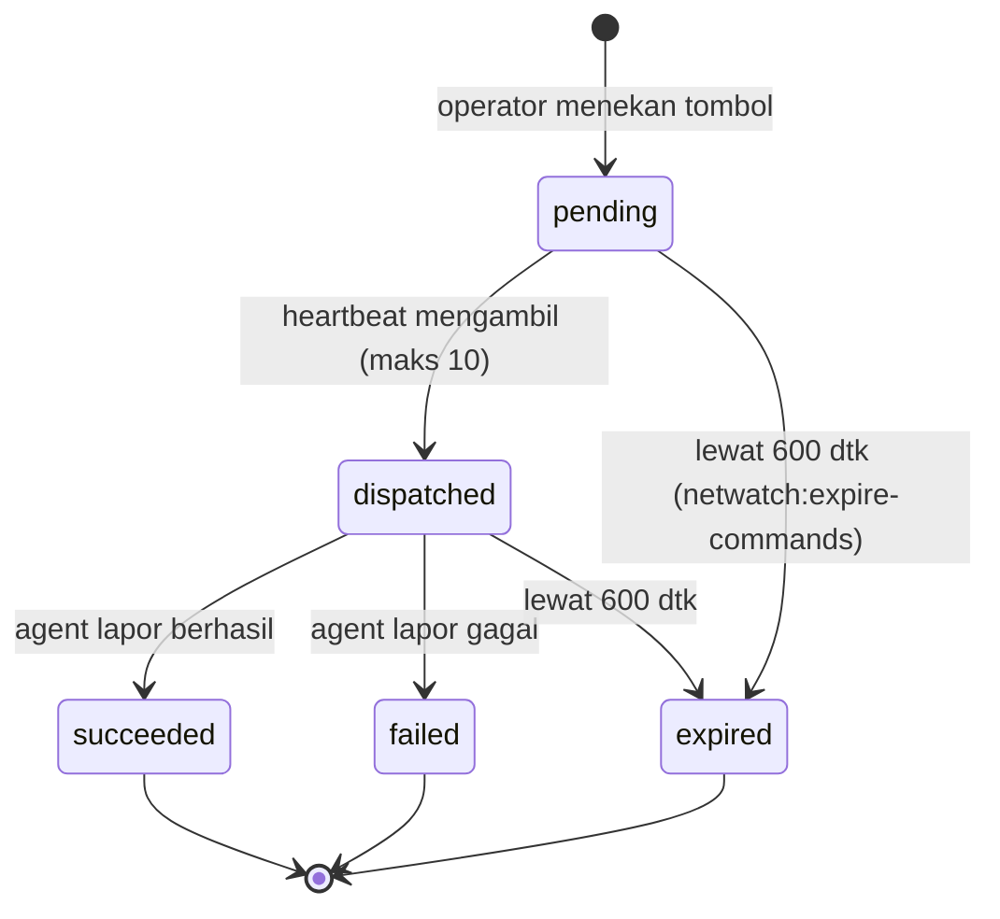
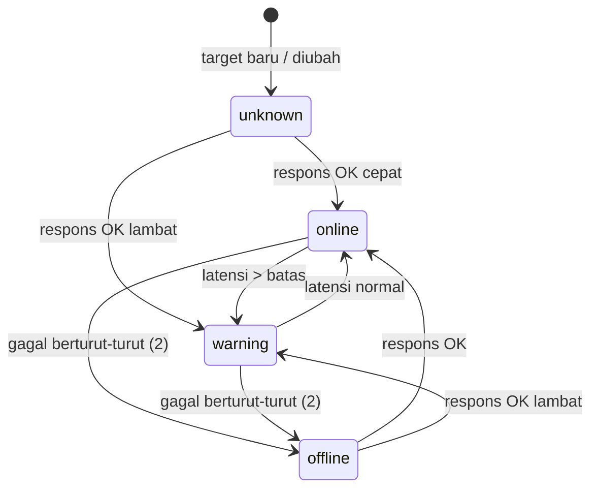
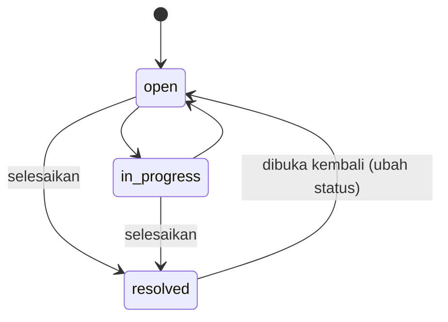

# Kode event, status, dan pesan galat

Dibuat dari `server/app/Support/EventCatalog.php` dan `server/app/Enums/*`. Event tampil di menu **Event** (Event Viewer). Kolom *Tindakan* adalah petunjuk yang sama dengan yang tampil di dashboard.

## 1. Katalog event (33 kode)

| Kode | Kategori | Tingkat | Petunjuk tindakan |
|---|---|---|---|
| `device.online` | Availability | Info | – |
| `device.offline` | Availability | Warning | Periksa apakah PC menyala dan tidak dalam mode sleep, kabel/WiFi tersambung, dan layanan "NetWatch Agent" berjalan. Server hanya melihat heartbeat berhenti, jadi tidak bisa membedakan keempat kemungkinan itu. Bila banyak perangkat offline bersamaan, curigai switch/AP atau server NetWatch itu sendiri. |
| `device.maintenance_started` | Availability | Info | – |
| `device.maintenance_ended` | Availability | Info | – |
| `device.enrolled` | Enrollment | Info | – |
| `device.revoked` | Enrollment | Warning | Akses perangkat dicabut. Agent di PC tersebut tidak bisa lagi mengirim data sampai didaftarkan ulang dengan token baru. |
| `device.enroll_rejected` | Security | Warning | Token pendaftaran salah, kedaluwarsa, sudah habis dipakai, atau dicabut. Bila terjadi berulang dari IP yang tidak dikenal, anggap sebagai percobaan tidak sah dan cabut token yang masih aktif. |
| `command.issued` | Command | Info | – |
| `command.failed` | Command | Warning | Lihat pesan galat. Penyebab umum: proses sudah berhenti sebelum perintah sampai, PID berubah sehingga ditolak demi keamanan, atau agent tidak punya hak untuk tindakan itu. |
| `command.expired` | Command | Warning | Perintah tidak diambil agent tepat waktu, biasanya karena perangkat offline. Ulangi setelah perangkat kembali online. |
| `auth.login_failed` | Security | Warning | Beberapa kegagalan beruntun dari IP yang sama menandakan tebakan kata sandi. Pertimbangkan menonaktifkan akun tersebut atau memblokir IP di firewall. Satu kegagalan biasanya hanya salah ketik. |
| `target.offline` | Connectivity | Warning | Perangkat jaringan tidak membalas ping/cek port dari server. Periksa daya dan kabel perangkat, lalu port switch di sisinya. Bila banyak target mati bersamaan, curigai switch/router di jalur menuju server NetWatch atau server NetWatch itu sendiri. Perangkat yang memblokir ICMP perlu dicek lewat port TCP, bukan ping. |
| `target.online` | Connectivity | Info | – |
| `target.slow` | Connectivity | Warning | Perangkat jaringan masih merespons tetapi lebih lambat dari batas (NETWATCH_MONITOR_WARN_MS). Penyebab umum: link jenuh atau loop, kabel/port bermasalah (cek error di switch), perangkat kelebihan beban, atau jalur ke server NetWatch padat. Bila banyak target lambat bersamaan, curigai uplink atau server NetWatch itu sendiri. |
| `target.normal` | Connectivity | Info | – |
| `backup.failed` | System | Critical | Backup database terjadwal gagal. Lihat pesan galat: biasanya ruang disk kurang, folder backup tidak bisa ditulis, path pg_dump salah (NETWATCH_PG_DUMP), atau kata sandi database berubah. Selama belum diperbaiki, backup terakhir yang berhasil adalah titik pemulihan Anda. |
| `policy.applied` | Policy | Info | – |
| `alert.firing` | Performance | Warning | Pemakaian sumber daya melewati ambang cukup lama. Buka Task Manager lewat perintah daftar proses di halaman perangkat untuk melihat proses yang boros. CPU tinggi terus-menerus biasanya proses macet/malware, RAM penuh butuh penutupan aplikasi atau tambah RAM, disk hampir penuh butuh pembersihan berkas atau penambahan kapasitas. |
| `alert.resolved` | Performance | Info | – |
| `policy.offline_release` | Policy | Info | Perangkat tidak dapat menghubungi server cukup lama (di luar jaringan kantor), sehingga agent melepas blokir. Blokir dipasang kembali otomatis begitu perangkat terhubung ke server lagi. |
| `policy.drift` | Policy | Warning | Aturan NetWatch di komputer tidak lagi sesuai kebijakan (dihapus/diubah manual, atau data agent hilang karena reinstal). Server mengirim ulang kebijakan dan agent menerapkannya kembali; bila berulang, periksa siapa yang mengubah file hosts atau registry. |
| `policy.failed` | Policy | Warning | Agent gagal menerapkan kebijakan blokir. Periksa pesan galat: biasanya agent tidak berjalan sebagai SYSTEM, file hosts dikunci antivirus, atau Windows Firewall dikelola penuh oleh GPO. Agent mencoba lagi tiap 5 menit. |
| `device.port_opened` | Security | Info | Port baru terbuka ke jaringan. Bila tidak dikenal, periksa proses yang membukanya di halaman "Port & layanan" perangkat, dan pastikan itu aplikasi yang sah. Port yang sama tidak diumumkan lagi dalam 24 jam. |
| `software.installed` | System | Info | Program baru terdeteksi di perangkat. Bila tidak dikenal, periksa halaman Inventaris perangkat tersebut. |
| `software.removed` | System | Info | – |
| `hardware.changed` | System | Warning | CPU, RAM, disk, atau model perangkat berbeda dari laporan sebelumnya: komponen diganti/ditambah, atau perangkat tertukar. Bandingkan dengan nomor seri di Inventaris. |
| `ticket.created` | System | Info | – |
| `ticket.resolved` | System | Info | – |
| `ticket.feedback` | System | Info | – |
| `winlog.event` | System | Warning | – |
| `user.created` | Security | Info | – |
| `user.deactivated` | Security | Info | – |
| `user.password_reset` | Security | Info | – |

Catatan: `winlog.event` memakai kategori hasil klasifikasi (`WinlogClassifier`), bukan kategori bawaan. Event `winlog.*` dan kategori keamanan hanya terlihat oleh admin.

## 2. Status dan enum

| Enum | Nilai |
|---|---|
| `ConnectionStatus` (perangkat) | `online`, `offline` |
| `TargetStatus` (NOC) | `unknown`, `online`, `warning` (Lambat), `offline` |
| `CommandStatus` | `pending`, `dispatched`, `succeeded`, `failed`, `expired` |
| `CommandType` | `refresh_processes`, `terminate_process`, `send_message`, `restart_computer`, `shutdown_computer` |
| `TicketStatus` | `open`, `in_progress`, `resolved` |
| `TicketPriority` | `low`, `normal`, `high` |
| `TicketCategory` | `network`, `hardware`, `software`, `account`, `other` |
| `UserRole` | `admin`, `operator`, `viewer` |
| `AlertMetric` | `cpu`, `memory`, `disk` |
| `BlockRuleType` | `domain`, `ip` |
| `Feature` | `bandwidth`, `browsing`, `inventory`, `winlog`, `network`, `tickets`, `threshold_alerts` |
| `EventSeverity` | `info`, `warning`, `critical` |
| `EventCategory` | `availability`, `connectivity`, `addressing`, `dns`, `performance`, `command`, `enrollment`, `security`, `policy`, `system` |
| `OsFamily` | `windows`, `linux` |

## 3. Pesan galat yang sering muncul

| Pesan | Asal | Arti dan tindakan |
|---|---|---|
| `Unauthenticated.` (401) | middleware `agent` | Token agent salah/dicabut. Daftar ulang agent. |
| `Token pendaftaran tidak valid atau sudah kedaluwarsa.` (403) | enroll | Token salah/habis/kedaluwarsa/dicabut. Buat token baru. |
| `Perintah ini tidak sedang menunggu hasil.` (409) | hasil perintah | Perintah sudah selesai/kedaluwarsa. Abaikan. |
| `Perangkat ini sudah dicabut akses-nya.` | kirim perintah | Perangkat dicabut; daftarkan ulang. |
| `Proses "…" dilindungi dan tidak boleh diakhiri.` | perintah | Proses sistem; disengaja. |
| `PID … sekarang milik proses lain; perintah dibatalkan demi keamanan.` | agent | PID dipakai ulang OS; segarkan daftar proses. |
| `Fitur "…" dinonaktifkan oleh administrator.` (404) | middleware feature | Aktifkan di menu Fitur. |
| `Email atau kata sandi salah.` | login | Cek akun/aktif; ada event `auth.login_failed`. |
| `Akun Anda dinonaktifkan.` | middleware active | Aktifkan akun di menu Pengguna. |
| `Harus tersisa minimal satu administrator aktif.` | pengguna | Jangan menurunkan admin terakhir. |
| `Ruang disk kurang untuk backup: …` | backup | Kosongkan/perbesar disk backup. |
| `pg_dump tidak bisa dijalankan: periksa path …` | backup | Pasang klien PostgreSQL / isi `NETWATCH_PG_DUMP`. |
| `Isi backup tidak lengkap (tabel users tidak ditemukan).` | backup | Salah `DB_SCHEMA` atau dump kosong. |
| `Checksum tidak cocok: berkas rusak atau berubah.` | verifikasi backup | Pakai backup lain. |
| `Penerapan kebijakan blokir belum didukung di Linux.` | agent Linux | Blokir hanya Windows. |
| `msg.exe tidak tersedia di edisi Windows ini` | agent | Windows Home tidak didukung untuk pesan. |
| `Server harus memakai HTTPS…` | agent | Pakai `https://` atau `--allow-insecure-http` (uji saja). |
| `Tidak dapat terhubung ke server: …` | agent | Jaringan/DNS/TLS. |
