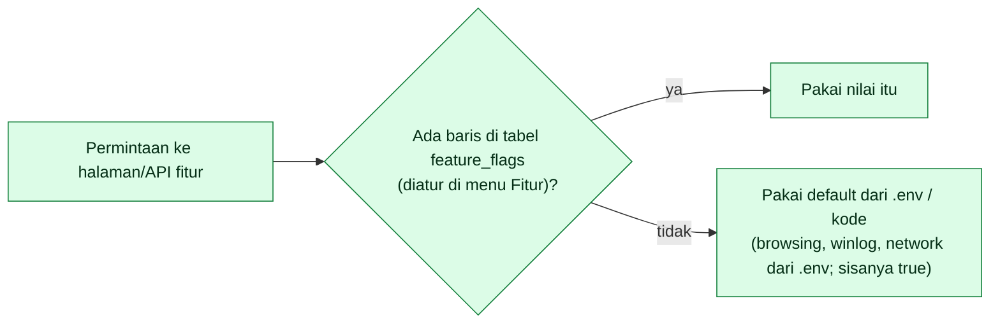

# Konfigurasi NetWatch — semua variabel `.env`

Sumber: `server/config/netwatch.php`, `server/config/database.php`, `server/bootstrap/app.php`, `server/.env.example`, dan `AppServiceProvider`. Bawaan di tabel adalah nilai **dalam kode** (bukan nilai di `.env.example`; bila berbeda, tertulis).

> **Setelah mengubah `.env` di produksi**: `sudo -u www-data php artisan config:clear && sudo -u www-data php artisan config:cache`. Tanpa itu nilai lama tetap dipakai (penyebab paling umum "sudah saya ubah tapi tidak berefek"). Pengaturan **Fitur** di dashboard disimpan di database dan **menimpa** nilai `.env` untuk fitur terkait (lihat §6).

## 1. Aplikasi dan database

| Variabel | Bawaan | Arti / catatan |
|---|---|---|
| `APP_NAME` | `NetWatch` | Nama aplikasi. |
| `APP_ENV` | `production` | `local` memunculkan peringatan di halaman Keamanan. |
| `APP_KEY` | – (wajib) | Dibuat `php artisan key:generate`. **Jangan diganti** setelah ada data: sesi terenkripsi dan data terenkripsi tak terbaca. Simpan salinannya. |
| `APP_DEBUG` | `false` | Harus `false` di produksi (halaman galat membocorkan konfigurasi). |
| `APP_URL` | – | URL publik dashboard (`https://…`). Host-nya otomatis **dilindungi dari pemblokiran policy**. |
| `APP_LOCALE`, `APP_TIMEZONE` | `id`, `UTC` | Data disimpan UTC; jangan ubah `APP_TIMEZONE`. |
| `LOG_CHANNEL`, `LOG_LEVEL` | `stack`, `warning` | Log di `storage/logs/laravel.log`. Naikkan ke `debug` sementara saat diagnosis. |
| `DB_CONNECTION` | `pgsql` | Hanya PostgreSQL yang didukung. |
| `DB_HOST`, `DB_PORT` | `127.0.0.1`, `5432` | – |
| `DB_DATABASE`, `DB_USERNAME`, `DB_PASSWORD` | `netwatch`, `netwatch`, kosong | – |
| `DB_URL` | – | Alternatif DSN tunggal. |
| `DB_SCHEMA` | `public` | Schema PostgreSQL. `netwatch` untuk database bersama (lihat `MERGE-DATABASE.md`). **Satu nama saja**, huruf/angka/garis bawah. |
| `DB_SSLMODE` | `prefer` | `require` / `verify-full` untuk DB di server lain. |
| `DB_CHARSET` | `utf8` | – |
| `SESSION_DRIVER` | `database` | Tabel `sessions`. |
| `SESSION_LIFETIME` | `120` | Menit. |
| `SESSION_SECURE_COOKIE` | `true` | Cookie hanya lewat HTTPS. Bila `false` di produksi → peringatan Keamanan. |
| `SESSION_SAME_SITE` | `strict` | – |
| `SESSION_ENCRYPT` | `true` | – |
| `CACHE_STORE` | `file` | – |
| `QUEUE_CONNECTION` | `sync` | NetWatch tidak memakai antrean; semua kerja lewat scheduler. |
| `BCRYPT_ROUNDS` | `12` | – |
| `MAIL_*` | – | Standar Laravel (`MAIL_MAILER`, `MAIL_HOST`, `MAIL_PORT`, `MAIL_USERNAME`, `MAIL_PASSWORD`, `MAIL_FROM_ADDRESS`, …). Dipakai oleh notifikasi email dan email penilaian tiket. `MAIL_MAILER=log`/`array` dianggap "belum dikonfigurasi". |

> Hanya `config/database.php` dan `config/netwatch.php` yang ada di folder `config/`; konfigurasi lain (app, session, mail, cache, …) memakai bawaan framework yang dibaca dari variabel standar di atas.

## 2. Jaringan dan keamanan

| Variabel | Bawaan | Arti / catatan |
|---|---|---|
| `NETWATCH_FORCE_HTTPS` | `true` | Memaksa skema HTTPS. Agent menolak `http://`. |
| `NETWATCH_TRUSTED_PROXIES` | kosong | IP reverse proxy (Nginx/Caddy), pisahkan koma. Tanpa ini IP klien terbaca sebagai IP proxy dan HTTPS tak terdeteksi (redirect loop / cookie ditolak). |
| `NETWATCH_SERVER_IPS` | kosong | IP server NetWatch (koma) yang **tidak boleh diblokir** policy. |
| `NETWATCH_TIMEZONE` | `Asia/Jakarta` | Zona waktu **tampilan** dan batas hari rollup browsing. |

## 3. Perangkat dan agent

| Variabel | Bawaan | Arti / catatan |
|---|---|---|
| `NETWATCH_HEARTBEAT_INTERVAL` | `30` | Detik; dikirim ke agent (dibatasi 5–3600 oleh agent). |
| `NETWATCH_OFFLINE_AFTER` | `120` | Detik tanpa heartbeat → offline. Harus > beberapa kali interval (disarankan ≥ 3×). |
| `NETWATCH_PROCESS_SNAPSHOT_INTERVAL` | `300` | Detik. |
| `NETWATCH_COMMAND_TTL` | `600` | Detik sebelum perintah yang tak diambil/diselesaikan `expired`. |
| `NETWATCH_ENROLLMENT_TTL_HOURS` | `24` | Masa berlaku bawaan token pendaftaran. |
| `NETWATCH_AGENT_LATEST_VERSION` | `1.6.0` | Agent di bawah versi ini ditandai usang di halaman Keamanan. **Ubah saat merilis agent baru.** |
| `NETWATCH_STALE_DEVICE_DAYS` | `30` | Perangkat tak terlihat selama ini ditandai usang. |
| `NETWATCH_PING_ENABLED` | `true` | Ping server → perangkat offline (membedakan PC mati vs agent mati). |
| Tetap di kode | – | `max_processes_per_snapshot` = 500, `max_block_rules_per_type` = 1000, `protected_processes` (daftar proses terlindungi), ping timeout 5 dtk. |

## 4. Fitur opsional

| Variabel | Bawaan | Arti / catatan |
|---|---|---|
| `NETWATCH_BROWSING_ENABLED` | `false` | Default saklar Browsing. Perhatikan kebijakan privasi. |
| `NETWATCH_BROWSING_DETAIL` | `domain` | `domain` atau `path` (query/kata pencarian tidak pernah disimpan). |
| `NETWATCH_BROWSING_MAX_PER_DEVICE_DAY` | `5000` | Batas baris mentah per perangkat per 24 jam. |
| `NETWATCH_WINLOG_ENABLED` | `false` | Default saklar Event Log klien (Windows & journald Linux). |
| `NETWATCH_MONITOR_ENABLED` | `true` | Default saklar NOC (target jaringan). |
| `NETWATCH_MONITOR_WARN_MS` | `150` | Respons lebih lambat → "Lambat". |
| `NETWATCH_MONITOR_FAIL_THRESHOLD` | `2` | Kegagalan beruntun sebelum Offline. |
| `NETWATCH_MONITOR_ALLOW_PUBLIC` | `false` | Izinkan target IP publik. |
| Tetap di kode | – | `monitor.timeout_seconds` = 3, `max_targets` = 1000. |
| `NETWATCH_FLEET_CACHE` | `4` | Detik cache halaman Monitoring; `0` = tanpa cache. |

## 5. Notifikasi

| Variabel | Bawaan | Arti / catatan |
|---|---|---|
| `NETWATCH_ALERTS_ENABLED` | `false` | Saklar utama notifikasi. |
| `NETWATCH_TELEGRAM_TOKEN`, `NETWATCH_TELEGRAM_CHAT_ID` | kosong | Keduanya wajib. Chat id grup biasanya negatif (`-100…`). |
| `NETWATCH_ALERT_MAIL_TO` | kosong | Penerima email, pisahkan koma. Pengirim memakai `MAIL_*`. |
| `NETWATCH_ALERT_MAX_AGE` | `3600` | Event lebih tua dari ini (detik) tidak dikirim. |
| `NETWATCH_ALERT_SLOW` | `true` | Kirim kabar "lambat"/"normal" target jaringan. |
| `NETWATCH_ALERT_SLOW_AFTER` | `180` | Lambat harus bertahan sekian detik sebelum dikirim. |
| Tetap di kode | – | `group_threshold` = 5 (≥ 5 offline sekaligus diringkas); daftar kode event yang dikirim. |

Uji: `php artisan netwatch:test-alert`.

## 6. Prioritas saklar fitur



Kunci fitur: `bandwidth`, `browsing`, `inventory`, `winlog`, `network`, `tickets`, `threshold_alerts`. Tombol "kembalikan default" di menu Fitur menghapus barisnya. Jika tabel `feature_flags` tak terbaca, sistem memakai default dan mencatat galat di log.

## 7. Retensi data (hari, kecuali disebutkan)

| Variabel | Bawaan | Data |
|---|---|---|
| `NETWATCH_RETENTION_HEARTBEATS` | 14 | `device_heartbeats` (grafik CPU/RAM; juga bahan alert) |
| `NETWATCH_SNAPSHOTS_KEEP` | 12 | jumlah snapshot proses per perangkat |
| `NETWATCH_RETENTION_BANDWIDTH_RAW` | 3 | sampel bandwidth mentah |
| `NETWATCH_RETENTION_BANDWIDTH` | 365 | ringkasan bandwidth per jam |
| `NETWATCH_RETENTION_BROWSING` | 14 | kunjungan mentah |
| `NETWATCH_RETENTION_BROWSING_DAILY` | 365 | ringkasan harian browsing |
| `NETWATCH_RETENTION_MONITOR` | 7 | `monitor_target_checks` |
| `NETWATCH_RETENTION_EVENTS` | 180 | Event Viewer |
| `NETWATCH_RETENTION_COMMANDS` | 90 | perintah selesai |
| `NETWATCH_RETENTION_AUDIT` | 365 | audit log |
| `NETWATCH_RETENTION_STATUS_HISTORY` | 730 | riwayat uptime (interval selesai) |

## 8. Backup

| Variabel | Bawaan | Arti |
|---|---|---|
| `NETWATCH_BACKUP_ENABLED` | `true` | – |
| `NETWATCH_BACKUP_PATH` | kosong → `storage/app/backups` | Sebaiknya disk lain (`/var/backups/netwatch`). |
| `NETWATCH_BACKUP_COPY_TO` | kosong | Salinan kedua. |
| `NETWATCH_BACKUP_KEEP_DAILY/WEEKLY/MONTHLY` | 7 / 4 / 6 | Rotasi. |
| `NETWATCH_PG_DUMP`, `NETWATCH_PG_RESTORE` | `pg_dump`, `pg_restore` | Path penuh bila tak ada di PATH. |
| `NETWATCH_BACKUP_MIN_FREE_MB` | 2048 | Ruang kosong minimum. |
| `NETWATCH_BACKUP_TIMEOUT` | 3600 | Detik. |
| `NETWATCH_BACKUP_EXCLUDE_DATA` | `device_heartbeats,process_snapshots,monitor_target_checks,interface_samples,sessions,cache,cache_locks` | Tabel yang datanya tidak ikut backup. |
| `NETWATCH_BACKUP_STALE_HOURS` | 36 | Backup lebih tua dari ini ditandai basi. |

## 9. Contoh `.env` produksi (Linux, DB khusus)

```dotenv
APP_ENV=production
APP_DEBUG=false
APP_URL=https://netwatch.perusahaan.local
DB_CONNECTION=pgsql
DB_HOST=127.0.0.1
DB_DATABASE=netwatch
DB_USERNAME=netwatch
DB_PASSWORD=GANTI-DENGAN-SANDI-KUAT
DB_SCHEMA=public
SESSION_SECURE_COOKIE=true
NETWATCH_FORCE_HTTPS=true
NETWATCH_TRUSTED_PROXIES=127.0.0.1
NETWATCH_BACKUP_PATH=/var/backups/netwatch
NETWATCH_ALERTS_ENABLED=true
NETWATCH_TELEGRAM_TOKEN=isi
NETWATCH_TELEGRAM_CHAT_ID=isi
```

## 10. Gejala salah konfigurasi

| Gejala | Kemungkinan variabel | Tindakan |
|---|---|---|
| Redirect berulang / login tak bertahan | `NETWATCH_TRUSTED_PROXIES` kosong di belakang proxy; `SESSION_SECURE_COOKIE` tanpa HTTPS | Isi IP proxy; akses via HTTPS |
| Semua perangkat berstatus berayun online/offline | `NETWATCH_OFFLINE_AFTER` ≤ interval heartbeat | Setel ≥ 3× interval |
| Tidak ada notifikasi | `NETWATCH_ALERTS_ENABLED=false`, token kosong, cache config lama | `config:cache` ulang; `netwatch:test-alert` |
| Backup gagal "pg_dump tidak bisa dijalankan" | `NETWATCH_PG_DUMP` | Path penuh |
| Tabel tidak ditemukan setelah merge DB | `DB_SCHEMA` salah / belum migrasi | `MERGE-DATABASE.md` |
| Halaman fitur 404 | Fitur dimatikan di menu Fitur | Aktifkan |
| Perubahan `.env` tidak berefek | Config ter-cache | `config:clear` + `config:cache` |
