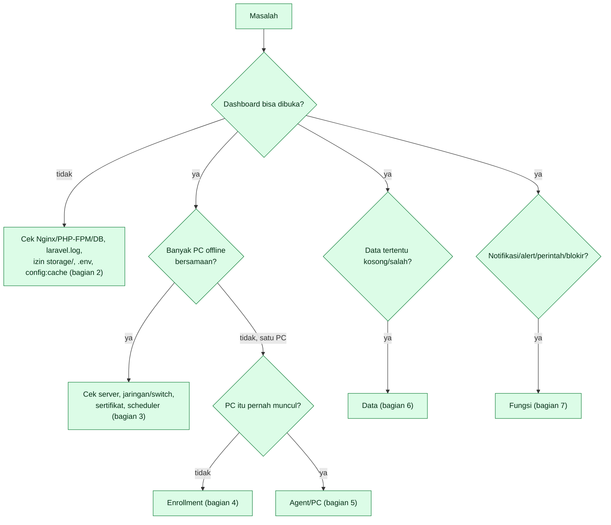

# Panduan troubleshooting NetWatch

Mulai dari **gejala**, ikuti pemeriksaan berurutan (paling murah dan paling sering dulu). Rujukan alur: [`ACTIVITY-DIAGRAM-PERANGKAT.md`](ACTIVITY-DIAGRAM-PERANGKAT.md) (A#) dan [`ACTIVITY-DIAGRAM-SERVER.md`](ACTIVITY-DIAGRAM-SERVER.md) (S#).

## 0. Pemeriksaan 2 menit (selalu lakukan dulu)

```bash
cd /var/www/netwatch/server
sudo -u www-data php artisan schedule:list                  # jadwal terdaftar
sudo -u www-data php artisan netwatch:security-check         # scheduler, HTTPS, token, versi agent
sudo -u www-data php artisan netwatch:db-stats               # DB, retensi, backup
tail -n 50 storage/logs/laravel.log
sudo systemctl status nginx php8.3-fpm postgresql
curl -kI https://localhost/login                              # harus 200
```

## 1. Pohon keputusan utama



## 2. Dashboard tidak bisa dibuka / galat

| Gejala | Penyebab umum | Cek | Perbaikan |
|---|---|---|---|
| 502/504 | PHP-FPM mati | `systemctl status php8.3-fpm` | Start; lihat log FPM |
| 500 | `.env` kosong, izin `storage/`, DB tak terhubung | `laravel.log` | `chown -R www-data storage bootstrap/cache`; periksa DB; `config:clear` |
| 500 setelah deploy | Cache lama | – | `artisan optimize:clear && config:cache` |
| "relation … does not exist" | Belum migrasi / `DB_SCHEMA` salah | `\dt netwatch.*` | `MERGE-DATABASE.md`; `migrate --force` |
| Redirect berulang | Proxy/HTTPS | `NETWATCH_TRUSTED_PROXIES`, `APP_URL` | Isi IP proxy; pakai HTTPS |
| Login terlempar terus | Cookie secure di HTTP; `APP_KEY` berubah | `SESSION_SECURE_COOKIE` | Akses via HTTPS; jangan ganti `APP_KEY` |
| 419 | CSRF/sesi kedaluwarsa | – | Muat ulang halaman |
| 403/404 menu | Peran/Fitur | menu Pengguna, menu Fitur | Ubah peran / aktifkan fitur |
| Lambat | DB besar, banyak tab | `db-stats`, `NETWATCH_FLEET_CACHE` | Pastikan prune jalan; naikkan cache |

## 3. Banyak PC offline bersamaan
1. Apakah server menerima apa pun? `tail -f /var/log/nginx/access.log | grep heartbeat`.
2. Tidak ada permintaan → jaringan/switch/DNS/firewall/sertifikat kedaluwarsa. Dari satu PC: `Test-NetConnection SERVER -Port 443`.
3. Ada permintaan tetapi 5xx → `laravel.log`, DB penuh/mati.
4. Ada permintaan 401 → token massal dicabut/`devices` dipulihkan dari backup lama; daftarkan ulang.
5. Offline hanya di dashboard tetapi permintaan masuk → **scheduler**/jam server (S11, `security-check`).
6. Pulih sendiri dalam beberapa menit → gangguan jaringan sesaat; event `device.online` memuat lama downtime.

## 4. PC tidak pernah muncul (enrollment)
Ikuti A1: token benar 64 karakter? belum kedaluwarsa/habis? URL `https://`? CA dipercaya? Lihat `agent.log` dan event `device.enroll_rejected`. Uji dengan `curl` (API-AGENT §4). Hostname valid (tanpa spasi)?

## 5. PC pernah muncul lalu offline / data berhenti
Di PC: tugas `NetWatchAgent` berjalan? (`schtasks /Query /TN NetWatchAgent /V`), baca `agent.log` (`AGENT-INTERNAL.md` §8). Bandingkan: ping merespons di halaman perangkat → PC hidup, agent berhenti; tidak merespons → PC mati/jaringan.
- Log "Token ditolak" → dicabut/diganti; daftarkan ulang.
- Log "Gagal berkomunikasi" → jaringan/TLS.
- Tidak ada log baru → agent tidak jalan; antivirus/GPO; `schtasks /Run`.

## 6. Data kosong atau salah

| Data | Cek urut |
|---|---|
| Grafik CPU/RAM | heartbeat masuk? (`device_heartbeats`), retensi 14 hari, zona waktu tampilan |
| Task manager lama | klik Segarkan; perangkat online? agent versi? |
| Bandwidth | menu Fitur aktif? agent mengirim `interfaces`? scheduler rollup (A8) |
| Browsing | fitur + `.env` aktif? `pdo_sqlite`? batas harian (A9) |
| Inventaris/Aset | fitur Inventaris, agent 1.6.0+, 10 menit pertama (A7) |
| Event Log | fitur Winlog; Windows/journald; agen berstatus online (A9) |
| Uptime janggal | `device_status_history`, `offline_after`, maintenance (A4) |
| NOC kosong | scheduler, `NETWATCH_MONITOR_ENABLED`, `ping` terpasang di server (S3) |

## 7. Fungsi

| Gejala | Langkah |
|---|---|
| Notifikasi tidak terkirim | S4: `ALERTS_ENABLED`, token/chat id, `config:cache`, `netwatch:test-alert`, `laravel.log`; ingat aturan penyaringan pasangan |
| Alert ambang tak menyala | S2: aturan aktif, cakupan, durasi, maintenance, scheduler |
| Perintah tak jalan | A5: status perintah di halaman perangkat; PC online? kedaluwarsa 10 mnt; proses terlindungi? |
| Pesan layar tak muncul | Windows Home tak punya `msg.exe`; sesi pengguna aktif? |
| Situs tak terblokir | A6: policy aktif, cakupan, Windows saja, DoH/VPN, `chrome://policy`, `policy.failed` |
| Semua diblokir | `netwatch-agent clear-policy` atau `recover-policy.ps1`; periksa aturan terlalu luas |
| Tiket tak terbuka dari PC | S6: DNS/CA; fitur Tiket; `curl` dari PC |
| Backup gagal | `BACKUP-DATABASE.md` tabel galat; S7 |
| Disk penuh | `db-stats`, prune, backup lama, `/var/log` |

## 8. Query diagnostik read-only
Awali nama tabel dengan `netwatch.` bila memakai schema terpisah. Kumpulan query siap pakai ada di [`KAMUS-DATA.md`](KAMUS-DATA.md) (bagian "Cara membaca data saat troubleshooting"). Contoh cepat:

```sql
SELECT hostname, last_seen_at, revoked_at, agent_version FROM devices ORDER BY last_seen_at DESC NULLS LAST LIMIT 20;
SELECT code, severity, occurred_at, message FROM events ORDER BY id DESC LIMIT 30;
SELECT status, count(*) FROM device_commands GROUP BY 1;
SELECT count(*) FILTER (WHERE notified_at IS NULL) AS belum_diproses FROM events;
```

## 9. Yang dikumpulkan sebelum eskalasi
1. Gejala, waktu kejadian (WIB), perangkat terdampak (hostname, versi agent).
2. 50 baris terakhir `laravel.log` (**tanpa** `.env`, token, sandi).
3. 50 baris terakhir `agent.log` dari PC terdampak.
4. Keluaran `netwatch:security-check` dan `netwatch:db-stats`.
5. Event terkait (menu Event) dan status perintah.
6. Versi: `RELEASE.txt`, `php -v`, `psql --version`, OS server.

Jangan menyertakan: isi `.env`, `agent.json` (berisi token), sandi, dump database.
